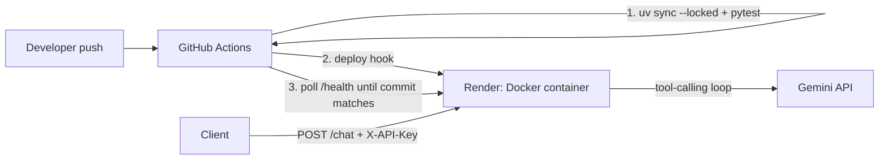

# Elder Activity Agent

An AI agent that watches phone sensor data (movement, light, charging) for signs that an older person has had a normal, active day, and sends a daily summary plus urgent alerts to family. No wearable needed: it uses the phone they already own.

**Status:** Phase 0 complete. A tool-using AI agent is live in the cloud, deployed automatically by a CI/CD pipeline after tests pass.

## Architecture



## Stack

| Layer | Choice |
|---|---|
| Language / packaging | Python 3.12, uv (lockfile for reproducible installs) |
| API | FastAPI |
| LLM | Google Gemini (Flash model, free tier) via `google-genai` |
| Container | Docker (uv-based image, non-root user, no dev dependencies) |
| Hosting | Render free web service |
| CI/CD | GitHub Actions: test, deploy, verify |
| Secrets | `.env` locally (git-ignored); Render environment variables in production |

## How the agent works

`app/agent.py` runs the core agent loop explicitly (automatic function calling is switched off so the loop is visible):

1. Send the user's message and the tool definitions to Gemini.
2. If Gemini requests tools, run them locally and send back the results.
3. Repeat until Gemini returns a final answer, capped at 5 steps.

Tools live in `app/tools.py`. Each is a plain Python function; the SDK builds the tool definition from its type hints and docstring.

| Tool | Purpose |
|---|---|
| `get_current_time(timezone)` | Current date and time in any IANA timezone |
| `calculate(expression)` | Safe arithmetic, parsed with `ast` rather than `eval()` |
| `days_until(target_date)` | Days from today to a YYYY-MM-DD date |

The agent can call tools in parallel (independent questions) or chain them (e.g. fetch the current year, then count days to Christmas).

## Run locally

Install [uv](https://docs.astral.sh/uv/), then:

```bash
uv sync                                   # installs Python 3.12 if needed, creates .venv
cp .env.example .env                      # Windows: copy .env.example .env
# edit .env with your real values

uv run pytest                             # no API key needed: Gemini is mocked in tests
uv run --env-file .env python -m app.agent "How many days until Christmas this year?"
uv run --env-file .env uvicorn app.main:app --reload   # then open http://localhost:8000/docs
```

Environment variables:

| Variable | Purpose |
|---|---|
| `GEMINI_API_KEY` | Key from Google AI Studio |
| `GEMINI_MODEL` | Gemini model name (defaults to the Flash model in `agent.py`) |
| `APP_API_KEY` | Password required on `/chat` via the `X-API-Key` header |

Add dependencies with `uv add <package>` (or `uv add --dev <package>`), and always commit `uv.lock`.

## API

| Endpoint | Description |
|---|---|
| `GET /health` | Returns `{"status": "ok", "commit": "<deployed git SHA>"}` |
| `POST /chat` | Body `{"message": "..."}`, header `X-API-Key`. Returns the answer plus a trace of tool calls |
| `GET /docs` | Interactive API docs |

Example:

```bash
curl -X POST https://<your-service>.onrender.com/chat \
  -H "Content-Type: application/json" -H "X-API-Key: <APP_API_KEY>" \
  -d '{"message": "What is 17 times 23, and what time is it in Tokyo?"}'
```

The free Render service sleeps after 15 minutes idle, so the first request after a quiet period can take up to a minute.

## CI/CD pipeline

Defined in `.github/workflows/deploy.yml`:

1. **Test** (every push and pull request): `uv sync --locked` fails if `uv.lock` is out of date, then `pytest` runs.
2. **Deploy** (pushes to `main` only, after tests pass): triggers Render through a secret deploy hook. Render's own auto-deploy is turned off, so untested code can never go live.
3. **Verify:** polls `/health` until it reports the exact commit that was pushed, so the pipeline confirms the *new* version is live, not just that the old one still responds.

GitHub repository secrets: `RENDER_DEPLOY_HOOK_URL`, `RENDER_SERVICE_URL`.

### Deploy your own copy

1. Sign up at render.com with GitHub (no card needed) and create a **Web Service** from this repo, runtime **Docker**, instance type **Free**.
2. Add the environment variables above; set **Health Check Path** to `/health` and **Auto-Deploy** to off.
3. Copy the **Deploy Hook** URL from the service settings.
4. Add the two GitHub secrets above, then push to `main`.

## Design notes

- **Resilience:** Gemini calls have a timeout and limited retries, so a slow or failing model returns a clear error instead of hanging. The API returns a 502 rather than crashing. Later phases add a rule-based fallback so safety alerts never depend on the LLM being available.
- **Security:** no secrets in the repo; `/chat` requires an API key, compared in constant time; the container runs as a non-root user; the calculator can't execute code.
- **Reproducibility:** one lockfile drives local development, CI and the Docker image.
- **Swappable model:** the model name is configuration, so it can change without a code change.
- **Privacy (later phases):** on Gemini's free tier, prompts may be used by Google to improve its products, so only anonymised activity summaries will ever be sent, never raw sensor data, names or locations.

## Roadmap

- [x] **Phase 0:** tool-using agent, tests, Docker, CI/CD to Render
- [ ] **Phase 1:** Android phone sends sensor data to an `/ingest` endpoint; stored in Postgres
- [ ] **Phase 2:** hourly activity features and charts
- [ ] **Phase 3:** personal baseline learning and rule-based triggers
- [ ] **Phase 4:** agent decisions, check-ins, daily summaries and urgent alerts via Telegram
- [ ] **Phase 5:** simulated scenarios to measure decision accuracy; uptime monitoring
- [ ] **Later:** migrate to AWS (Lambda + scheduler), native Android app, family dashboard
