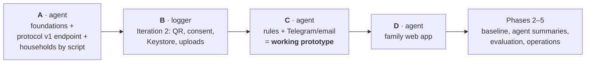

# Roadmap

The goal is a **working prototype as soon as possible**: a phone records and uploads, the server notices when there has been no activity for too long, and a family member gets a Telegram or email message. The family web app comes straight after, turning the prototype into something a family can use without the developer.

The phone app is the separate **phone-sensor-logger** project ([ADR 0023](adr/0023-phone-sensor-logger-as-data-source.md)). Its Iteration 2 (connected logger) is step B below.

## The fast path: four steps

| Step | Repo | Content | Result | Decisions |
|---|---|---|---|---|
| ✅ Done | agent | Phase 0 and Phase 1 A–B: agent, CI/CD, Postgres, per-device tokens, idempotent batches, minute summaries, security baseline | Data from Sensor Logger stored | 0001–0022 |
| ✅ **A** | agent | **Foundations:** typed settings (`config/settings.toml`, every setting commented with unit and range, including `pairing.pending_token_expiry_minutes`), ruff with docstring rules, mypy, pre-commit, docstrings on existing code, Python version policy. **Protocol v1:** `POST /v1/readings` with a vendored protocol and contract tests, Problem Details errors, per-device rate limiting, location ignored. **Households:** tables for households, people, devices (pending, active, revoked) and screen/activity events; `scripts/household.py` creates a household and person and prints the setup QR code in the terminal | The server accepts the logger's data | 0023, 0024, 0027 |
| **B** | logger | Iteration 2 in one pull request: Keystore token, manual and QR setup, consent, uploads every interval, status, rejected token, remove connection; publisher name and logo from configuration | A phone uploads to the server | logger 0021 |
| ✅ **C** | agent | Alert contact and settings tables; inactivity and phone-silent rules with per-person settings; alert lifecycle (open, acknowledged, resolved); email and Telegram notifiers; LLM explanation with a template fallback; `/jobs/check-alerts` on a GitHub Actions schedule; contacts added and Telegram linked with `household.py`; `scripts/simulate_phone.py` to try alerts without the logger app | **Working prototype:** leave the phone still and a message arrives | 0026 |
| **D** | agent | Family and care web app: access by set of people (ADR 0028), the care overview (red, amber, green) for users with several people, email sign-in, sessions, CSRF, household isolation tests, Today and past days, Add phone (QR), devices, contacts, alert settings, members; brand from `config/brand.toml`; PWA; axe-core and Lighthouse in CI | A family can use it without the developer | 0024, 0025 |
| Backend SRS | agent | Requirements written from what steps A–D built, with traceability like the logger's | Reviewable specification | |
| Phase 2 | agent | Daily activity features (wake time, active minutes, longest inactive period) | | |
| Phase 3 | agent | Personal baseline; new rules with scenario tests | | |
| Phase 4 | agent | Daily summaries; family members ask questions about the day | | 0004, 0005, 0017 |
| Phase 5 | both | Scenario testing of alerts, monitoring, retention jobs, test distribution to a family | | 0029 |
| Care organisations | agent | Several staff sharing people, assigning people to staff, shift handover, alert digests, audit reports | | |
| Before real users | agent | Legal review, privacy policy, Australian region, least-privilege database logins, row-level security | | 0019, 0022 |

**Order (changed 2026-11-23):** all agent work first (A, C, D, then the SRS), then logger step B, then Phases 2–5. Alerts are tried before the logger app exists with `scripts/simulate_phone.py`, which sends protocol v1 batches with a real device token; the first end-to-end test with a real phone follows step B.

ADR 0029 (test distribution) is reserved for the step that makes that decision.

## Ways of working

- **One pull request per step**, closing that step's stories (`Closes #…`). Larger pull requests, so the checks in CI stay strict.
- Changes arrive as patches built from the latest `main`; CI results are read directly from GitHub Actions to fix failures without screenshots.
- Dependabot opens at most one pull request per ecosystem a week (grouped).
- The SRS is written after the prototype, from the stories in [backlog/working-version.md](backlog/working-version.md) and what was built.

## Definition of done for the working prototype (end of step C)

- A phone set up with the QR code printed by `household.py` uploads every 15 minutes, after its owner agrees on the phone.
- With the phone left still for longer than the inactivity setting during waking hours, a Telegram message and an email arrive within 15 minutes; acknowledging one stops repeats; activity resuming closes the alert.
- If the LLM is unavailable, the alert still arrives with the template text.
- No secret appears in the repository, logs or messages; the threat model is up to date.

## Definition of done for the family web app (end of step D)

- A family member who isn't a developer can sign in, add a phone and see data arriving, using only their own phone.
- Two households on the same deployment can't see each other's data (tested).
- The web app passes axe-core with no violations at 320, 375 and 412 px, and Lighthouse accessibility is at least 95.
