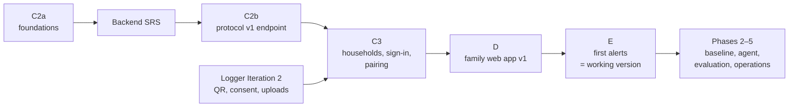

# Roadmap

The goal of the next stages is a **working version**: a family member signs in, connects their relative's phone by scanning a QR code, sees how the day is going, and gets an email or Telegram message when the phone shows no activity for too long.

The phone app is the separate **phone-sensor-logger** project ([ADR 0023](adr/0023-phone-sensor-logger-as-data-source.md)). Its Iteration 2 (connected logger) is built alongside Stages C2b and C3 here.

| Stage | Goal | Main content | Decisions |
|---|---|---|---|
| ✅ Phase 0 | Agent, tests and deployment | Tool-calling agent, Docker, CI/CD | 0001–0009 |
| ✅ Phase 1, A and B | Storage and authenticated ingestion | Postgres, migrations, per-device tokens, idempotent batches, minute summaries, security baseline | 0011–0022 |
| C2a | Foundations | Typed settings (`config/settings.toml`, every setting commented with unit and range), ruff (including docstring rules), mypy, pre-commit, docstrings added to existing code ([CONTRIBUTING.md](../CONTRIBUTING.md)), Python version policy | 0027 |
| Backend SRS | Requirements before building for families | `docs/requirements/srs.md` from [backlog/working-version.md](backlog/working-version.md), with traceability like the logger's | |
| C2b | Accept the logger's data | `POST /v1/readings` with a vendored protocol v1 and contract tests, Problem Details errors, per-device rate limiting; location ignored | 0023 |
| C3 | Families can connect a phone | Households, people, members (owner, viewer); email magic-link sign-in and sessions; "Add phone" with the QR code and configurable pending expiry; household isolation tests; first accessible pages and the PWA shell | 0024, 0025 |
| D | Families can see the day | Today and per-day views (active hours, steps, last activity, phone battery, last seen); devices page with revoke; alert contacts with Telegram linking; staging environment | 0025 |
| E | **Working version**: families are told | Inactivity and phone-silent rules with household settings; alert lifecycle; email and Telegram notifiers; LLM explanation with a template fallback; scheduled check | 0026 |
| Phase 2 | Features | Daily activity features (wake time, active minutes, longest inactive period) | |
| Phase 3 | Personal baseline | Compare with the person's own routine; new rules with scenario tests | |
| Phase 4 | Agent | Daily summaries; family members ask questions about the day | 0004, 0005, 0017 |
| Phase 5 | Evaluation and operations | Scenario testing of alerts, monitoring, retention jobs, test distribution to a family | 0028 |
| Before real users | Compliance and hosting | Legal review, privacy policy, Australian region, least-privilege database logins, row-level security | 0019, 0022 |

ADR numbers 0027 (Python version policy) and 0028 (test distribution) are reserved for the stages that make those decisions.

## Definition of done for the working version

- A family member who isn't a developer can sign in, add a phone and see data arriving, using only their own phone.
- Two households on the same deployment can't see each other's data (tested).
- The web app passes axe-core with no violations at 320, 375 and 412 px, and Lighthouse accessibility is at least 95.
- With the phone left still for longer than the inactivity setting during waking hours, an email and a Telegram message arrive within 15 minutes, and acknowledging one stops repeats.
- No secret appears in the repository, logs or alerts; the threat model is up to date.
