# Architecture

Sections 1 to 8 show how the system looks **today** (end of Phase 1, Stage B). [Section 9](#9-target-architecture-the-working-version) shows the **target for the working version** (steps A to D in the [roadmap](ROADMAP.md)). For *why* it looks like this, see the [Architecture Decision Records](adr/README.md). Diagrams follow the [C4 model](https://c4model.com): each level zooms in further.

Dashed lines show parts that are planned but not built yet.

## 1. System context (C4 level 1)

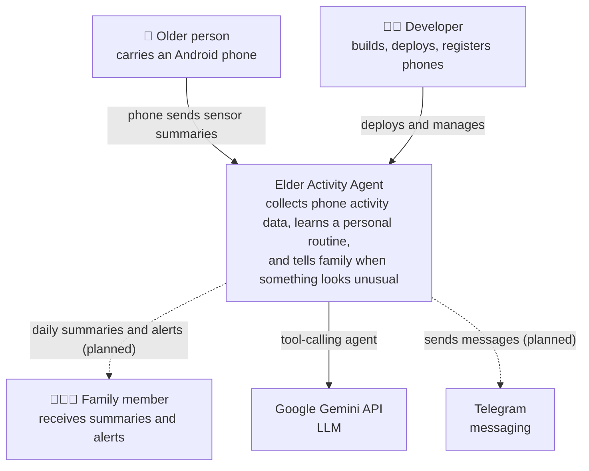

## 2. Containers (C4 level 2)

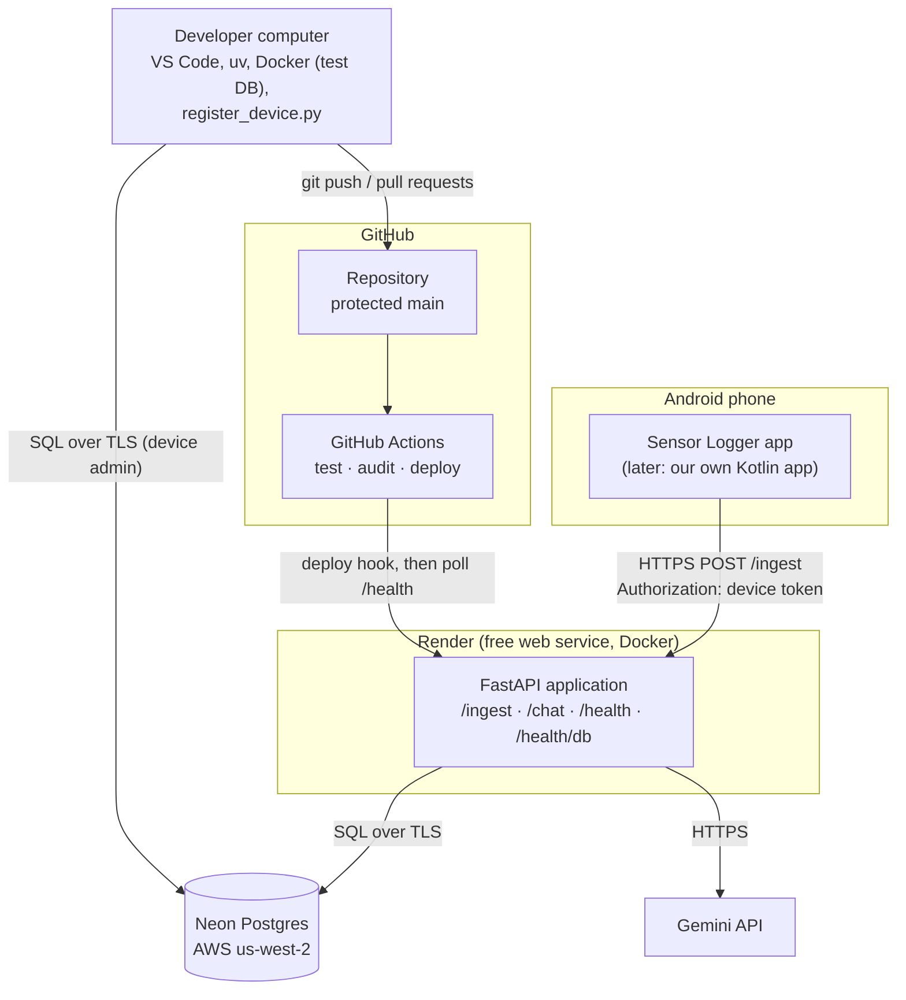

| Container | Technology | Responsibility |
|---|---|---|
| Phone app | Sensor Logger (temporary) | Records light, battery and steps; pushes a batch every second |
| API | Python 3.12, FastAPI, SQLAlchemy, Docker on Render | Authenticates devices, validates and stores data, runs the agent |
| Database | Neon serverless Postgres, Alembic migrations | Devices, batches, step totals, per-minute summaries |
| LLM | Gemini Flash | Agent reasoning and wording |
| CI/CD | GitHub Actions | Tests against a Postgres container, dependency audit, gated deploys |

## 3. Components inside the API (C4 level 3)

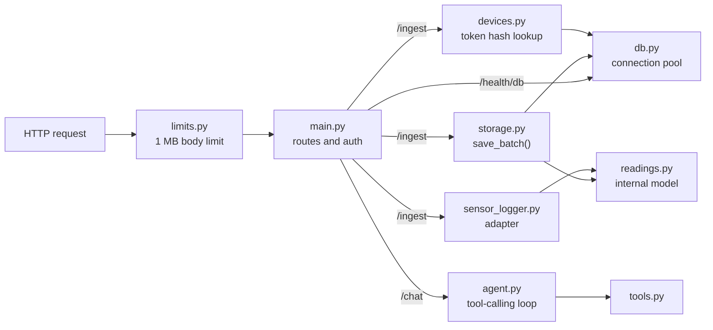

The adapter is the only code that knows Sensor Logger's format ([ADR 0014](adr/0014-own-ingest-contract.md)). Replacing the phone app means replacing that one file.

## 4. What happens when a batch arrives

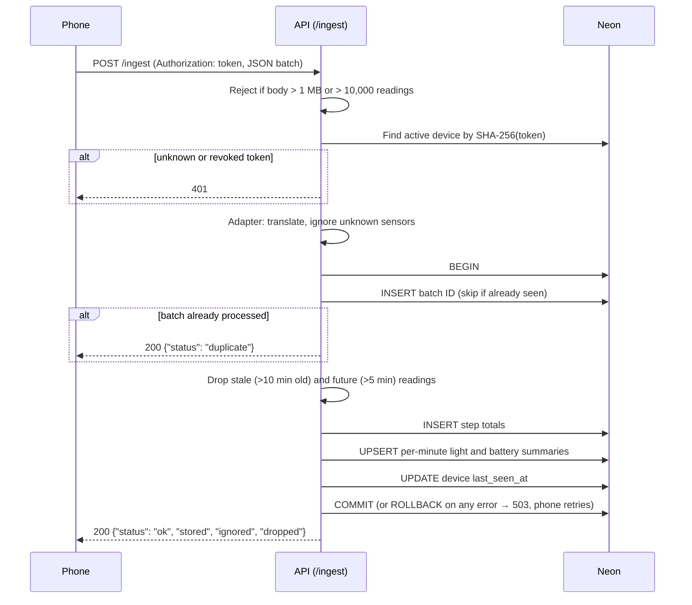

## 5. Data model

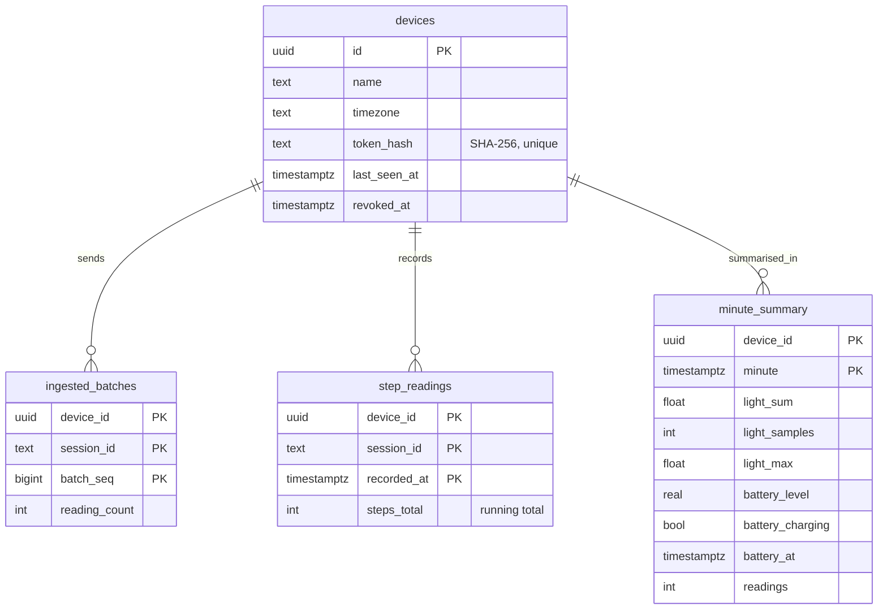

All timestamps are stored in UTC; each device's timezone is used when showing data.

## 6. Delivery pipeline

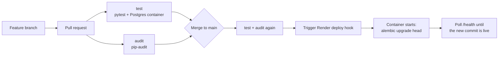

Dependabot opens pull requests for dependency, GitHub Actions and Docker image updates; CodeQL scans the code on GitHub.

## 7. Quality goals and where they're addressed

| Goal | How | Decisions |
|---|---|---|
| Reliability | Idempotent batches, transactions, retry-safe errors, LLM timeouts | [0013](adr/0013-aggregate-at-ingestion.md), [0017](adr/0017-llm-resilience.md) |
| Security | Per-device hashed tokens, request limits, secrets hygiene, supply-chain checks | [0011](adr/0011-ingest-authentication.md), [0019](adr/0019-security-baseline.md)–[0021](adr/0021-supply-chain-security.md) |
| Privacy | Data minimisation, summaries only to the LLM | [0005](adr/0005-gemini-flash-llm.md), [0022](adr/0022-data-minimisation-retention-residency.md) |
| Cost (free tier) | Aggregation at ingest, database-free health check | [0006](adr/0006-render-hosting.md), [0012](adr/0012-neon-postgres.md), [0016](adr/0016-health-checks-avoid-database.md) |
| Replaceable parts | Own ingest contract with adapters; model name as configuration | [0014](adr/0014-own-ingest-contract.md) |

## 8. Not built yet

- Protocol v1 endpoint, households and command-line pairing (step A), replacing the Sensor Logger adapter
- Rules, alerts by email and Telegram (step C)
- Sign-in and the family web app (step D)
- Activity features, personal baseline, agent summaries (Phases 2–4)
- Least-privilege database logins, retention jobs, row-level security

## 9. Target architecture: the working version

Decisions: [0023](adr/0023-phone-sensor-logger-as-data-source.md) (data source), [0024](adr/0024-households-and-pairing.md) (households and pairing), [0025](adr/0025-family-web-app.md) (web app), [0026](adr/0026-rules-decide-llm-explains.md) (alerts). User stories: [backlog/working-version.md](backlog/working-version.md).

### 9.1 System context

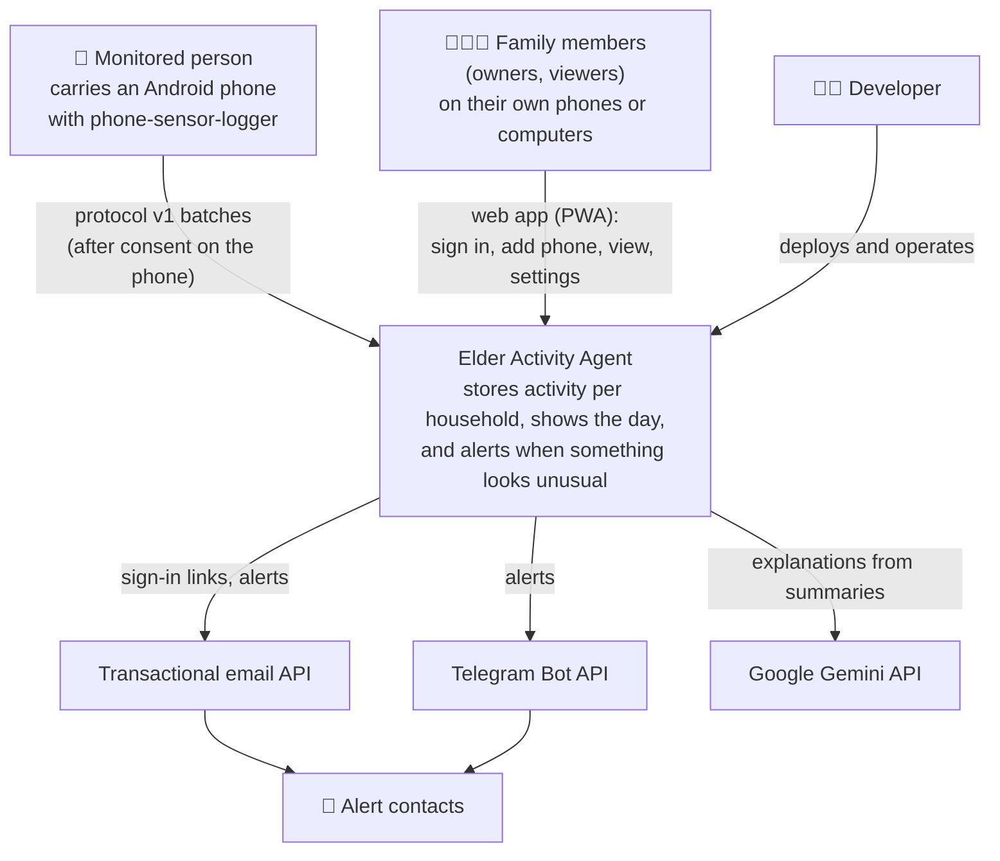

### 9.2 Containers

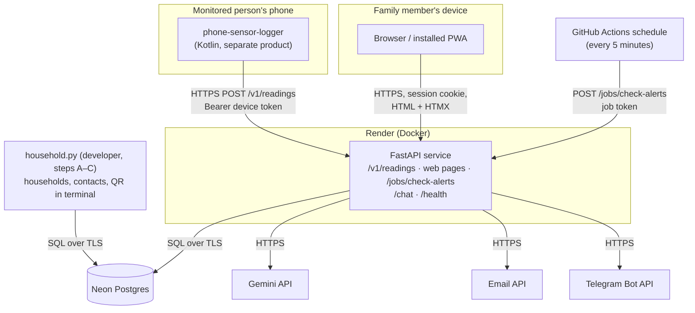

### 9.3 Components

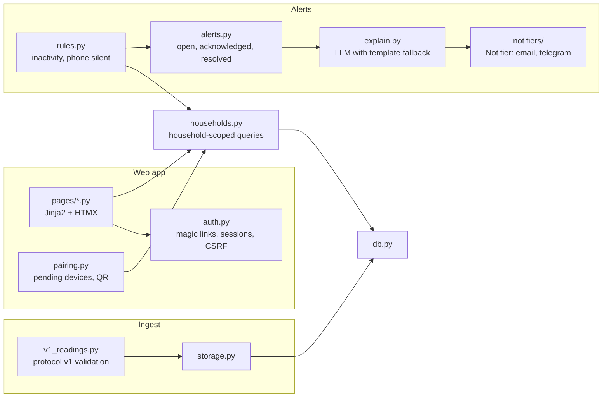

Every read of household data goes through `households.py`, which takes the signed-in member's household: this is where isolation is enforced and tested.

### 9.4 Pairing a phone

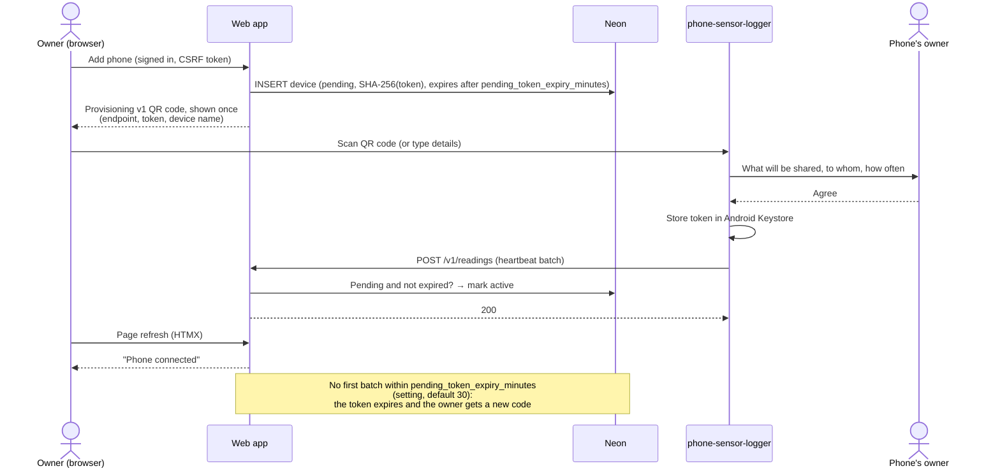

### 9.5 Checking for and sending an alert

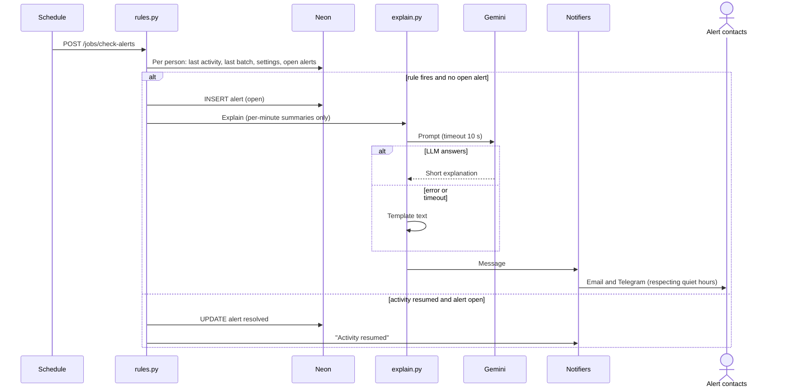

### 9.6 Target data model

New tables, added to those in section 5 (`devices` gains `person_id`, `status` and `pending_expires_at`).

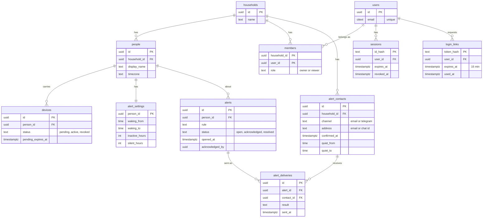

### 9.7 Quality goals added for the working version

| Goal | How | Decisions |
|---|---|---|
| Household isolation | One module for scoped queries; cross-household tests on every route | [0024](adr/0024-households-and-pairing.md) |
| Accessible on any phone | WCAG 2.2 AA, mobile-first CSS, axe-core and Lighthouse in CI, manual screen-reader checks | [0025](adr/0025-family-web-app.md) |
| Alerts are dependable | Rules with scenario tests; LLM never on the critical path | [0026](adr/0026-rules-decide-llm-explains.md) |
| Replaceable phone app | Only protocol v1 crosses the boundary; contract tests | [0023](adr/0023-phone-sensor-logger-as-data-source.md) |
