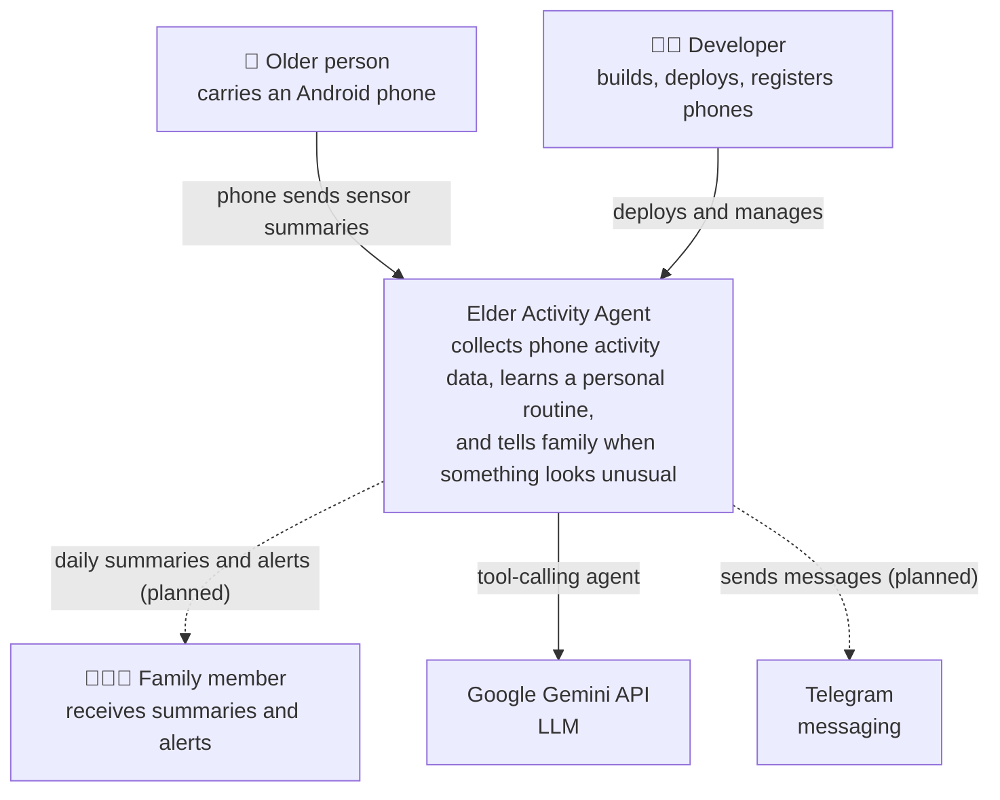
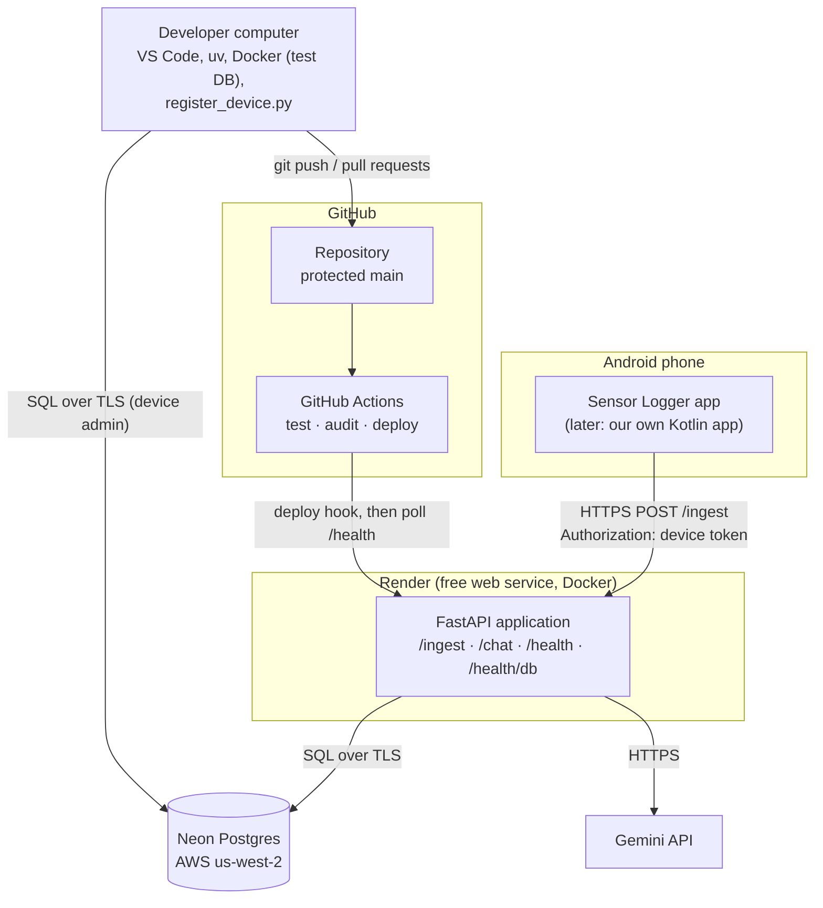
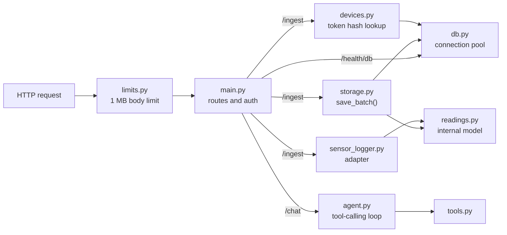
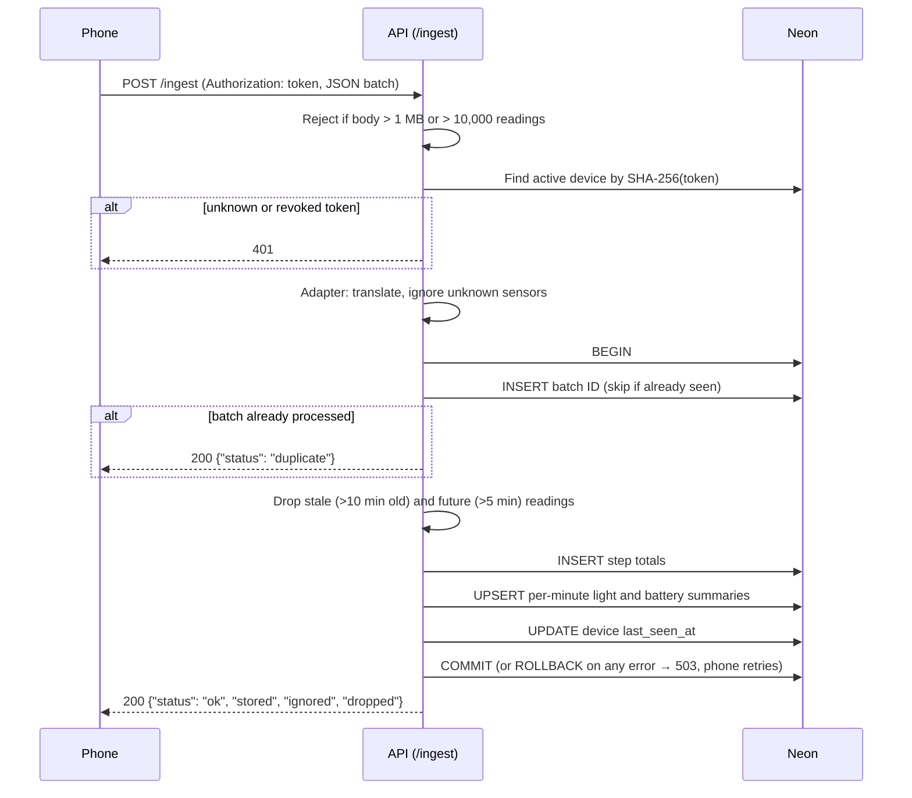
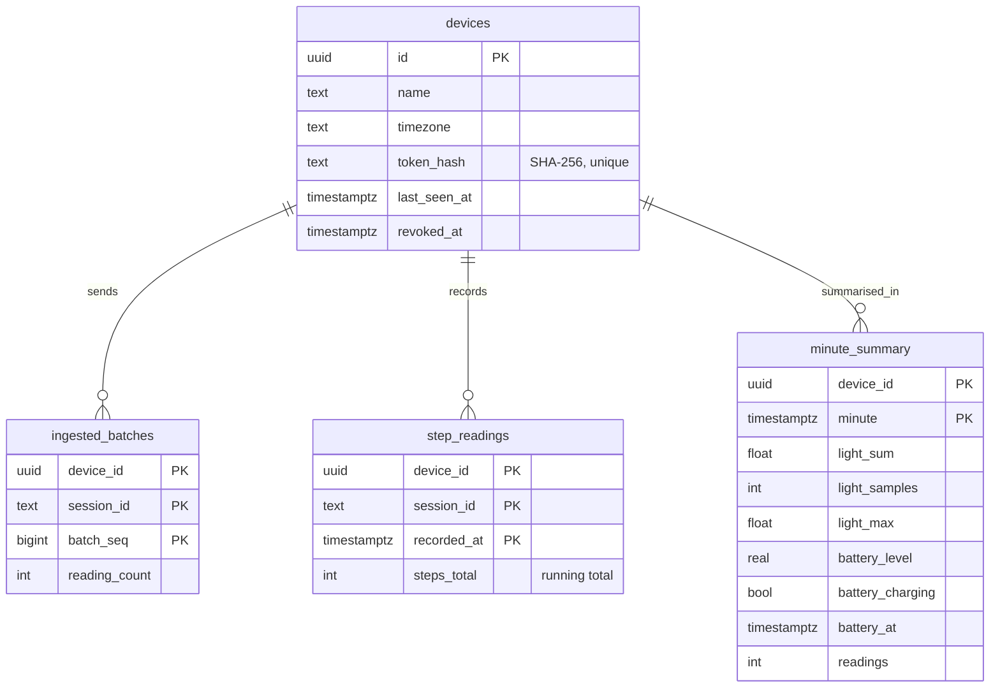
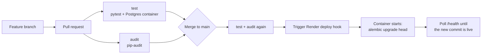

# Architecture

How the system looks **today** (end of Phase 1, Stage B). For *why* it looks like this, see the [Architecture Decision Records](adr/README.md). Diagrams follow the [C4 model](https://c4model.com): each level zooms in further.

Dashed lines show parts that are planned but not built yet.

## 1. System context (C4 level 1)

## 2. Containers (C4 level 2)

| Container | Technology | Responsibility |
|---|---|---|
| Phone app | Sensor Logger (temporary) | Records light, battery and steps; pushes a batch every second |
| API | Python 3.12, FastAPI, SQLAlchemy, Docker on Render | Authenticates devices, validates and stores data, runs the agent |
| Database | Neon serverless Postgres, Alembic migrations | Devices, batches, step totals, per-minute summaries |
| LLM | Gemini Flash | Agent reasoning and wording |
| CI/CD | GitHub Actions | Tests against a Postgres container, dependency audit, gated deploys |

## 3. Components inside the API (C4 level 3)

The adapter is the only code that knows Sensor Logger's format ([ADR 0014](adr/0014-own-ingest-contract.md)). Replacing the phone app means replacing that one file.

## 4. What happens when a batch arrives

## 5. Data model

All timestamps are stored in UTC; each device's timezone is used when showing data.

## 6. Delivery pipeline

Dependabot opens pull requests for dependency, GitHub Actions and Docker image updates; CodeQL scans the code on GitHub.

## 7. Quality goals and where they're addressed

| Goal | How | Decisions |
|---|---|---|
| Reliability | Idempotent batches, transactions, retry-safe errors, LLM timeouts | [0013](adr/0013-aggregate-at-ingestion.md), [0017](adr/0017-llm-resilience.md) |
| Security | Per-device hashed tokens, request limits, secrets hygiene, supply-chain checks | [0011](adr/0011-ingest-authentication.md), [0019](adr/0019-security-baseline.md)–[0021](adr/0021-supply-chain-security.md) |
| Privacy | Data minimisation, summaries only to the LLM | [0005](adr/0005-gemini-flash-llm.md), [0022](adr/0022-data-minimisation-retention-residency.md) |
| Cost (free tier) | Aggregation at ingest, database-free health check | [0006](adr/0006-render-hosting.md), [0012](adr/0012-neon-postgres.md), [0016](adr/0016-health-checks-avoid-database.md) |
| Replaceable parts | Own ingest contract with adapters; model name as configuration | [0014](adr/0014-own-ingest-contract.md) |

## 8. Not built yet

- `v1` ingest contract (Stage C) and data view endpoint (Stage D)
- Our own Android app
- Activity features, personal baseline, agent decisions and Telegram alerts (Phases 2–4)
- Rate limiting, least-privilege database logins, retention jobs
