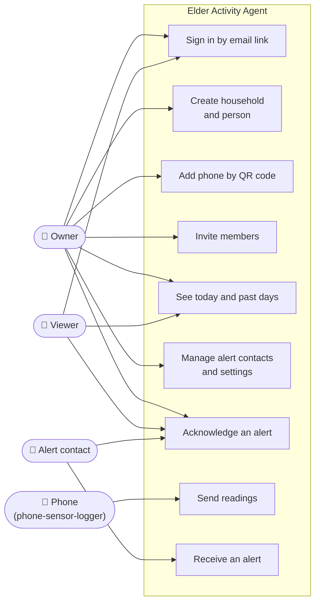

# Backlog: working version (Stages C2b to E)

User stories for the [roadmap](../ROADMAP.md)'s working version. Each is written as "As a *role*, I want *capability*, so that *benefit*", with acceptance criteria in Given/When/Then form. The backend SRS turns these into numbered requirements; until then, story IDs are the reference for issues and pull requests.

## Roles

| Role | Who | Uses |
|---|---|---|
| **Monitored person** | The older person carrying the phone | The phone (phone-sensor-logger); receives nothing from this service |
| **Owner** | A family member who manages the household | Web app: everything |
| **Viewer** | Another family member or a carer | Web app: views and acknowledges alerts |
| **Alert contact** | Anyone who should be told (often a member) | Email or Telegram |
| **Developer** | Builds and runs the service | Command line, CI, hosting |

## Use cases

## Stage C2b: accept the logger's data

### C2b-1 Receive protocol v1 batches
*As a* developer, *I want* `POST /v1/readings` to accept phone-sensor-logger's protocol v1 batches, *so that* the logger's data is stored without an adapter.
- Given every valid example in the vendored protocol, when posted with a valid token, then it is accepted with the status the example's manifest expects.
- Given every invalid example, when posted, then it is rejected with a Problem Details response and nothing is stored.
- Given the same `(session_id, batch_seq)` twice, when posted, then the second is reported as a duplicate and nothing is counted twice.
- Given a batch with location readings, when posted, then they are ignored and not stored.

### C2b-2 Limit each device's requests
*As a* developer, *I want* per-device rate limiting, *so that* one faulty or stolen phone can't overload the service.
- Given a device over its limit, when it posts, then it gets 429 with `Retry-After`, and other devices are unaffected.

## Stage C3: families can connect a phone

### C3-1 Sign in by email link
*As an* owner or viewer, *I want* to sign in by entering my email and opening a link, *so that* I have no password to remember.
- Given a known or unknown email, when submitted, then the same "check your email" page is shown (no account discovery).
- Given a link, when opened within 15 minutes for the first time, then I am signed in; when opened again or later, then it is refused with a way to request a new one.
- Given more than 5 requests for one address in an hour, when another is made, then no email is sent.
- Given I sign out, when the old session cookie is reused, then it is refused.

### C3-2 Create a household
*As a* new user, *I want* to create a household with the person I'm looking after (name and timezone), *so that* I can add their phone.
- Given I'm signed in with no household, when I create one, then I am its owner and can add a person.

### C3-3 Add a phone by QR code
*As an* owner, *I want* to add a phone by scanning a QR code with the logger app, *so that* I don't type a long address and token.
- Given "Add phone", when tapped, then a provisioning v1 QR code is shown once, with the endpoint and token as text below it for typing, and how long the code works for.
- Given the expiry setting `pairing.pending_token_expiry_minutes` (default 30), when the phone uploads its first batch within it, when the page refreshes, then it shows "Phone connected".
- Given no batch within the expiry time, when the phone tries later, then it gets 401, and the page offers a new code.
- Given the setting is 1 minute in a test, when a phone's first batch arrives after 61 seconds, then it gets 401.
- Given a value outside 5 to 1440 in configuration (tests aside), when the app starts, then it refuses to start and names the setting.
- Given a device, when the owner revokes it, then its next upload gets 401.

### C3-4 Invite a member
*As an* owner, *I want* to invite someone by email as a viewer or owner, *so that* others in the family can see the day and acknowledge alerts.
- Given an invitation, when accepted through the email link, then the person joins with the chosen role.
- Given a viewer, when they open settings, devices or contacts, then they can view but not change them.

### C3-5 Keep households apart
*As an* owner, *I want* no one outside my household to see anything about it, *so that* my relative's routine stays private.
- Given members of households A and B, when A's member requests any of B's pages, endpoints or ids, then the response is 404.

### C3-6 Use the web app comfortably on any phone
*As an* owner or viewer, *I want* pages that fit my phone's screen, work with large text and a screen reader, and can be added to my home screen, *so that* I can use it wherever I am.
- Given widths of 320, 375 and 412 px, when every page is tested with axe-core, then there are no violations and no horizontal scrolling.
- Given text at 200%, when any page is shown, then nothing is cut off or overlapping.
- Given a screen reader, when an HTMX update happens, then it is announced.
- Given a supported browser, when the app is opened, then it can be installed to the home screen.

## Stage D: families can see the day

### D-1 See today at a glance
*As an* owner or viewer, *I want* a today page showing the last activity, steps so far, active hours, phone battery and when the phone last sent data, *so that* I know in seconds whether all looks normal.
- Given data in the last hour, when the page opens, then "Last active" shows the time in the person's timezone.
- Given the phone hasn't sent data for over an hour, when the page opens, then this is shown clearly and separately from activity.
- Given any page, when inspected, then no location is shown.

### D-2 Look back at past days
*As an* owner or viewer, *I want* to see each past day's activity by hour, *so that* I can spot changes in routine.
- Given 14 days of data, when I choose a day, then its hourly activity and totals are shown, with a text alternative to the chart.

### D-3 Manage alert contacts
*As an* owner, *I want* to add email and Telegram contacts with quiet hours, *so that* the right people are told at sensible times.
- Given an email contact, when added, then a confirmation email must be opened before alerts are sent to it.
- Given a Telegram contact, when they open the one-time link and press Start, then their chat is linked and a test message arrives.

## Stage E: first alerts (working version)

### E-1 Alert on inactivity
*As an* alert contact, *I want* to be told when there has been no activity for too long during waking hours, *so that* I can check on my relative.
- Given waking hours 08:00 to 21:00 and 4 hours of inactivity, when the phone sends data with no steps or screen use from 09:00 to 13:00, then one alert is sent to each contact by 13:15.
- Given activity resumes, when the next check runs, then the alert is resolved and contacts are told.
- Given an open alert, when checks keep running, then it isn't sent again except as the configured resend.

### E-2 Alert when the phone goes silent
*As an* alert contact, *I want* to be told when the phone has stopped sending data, worded as a phone problem, *so that* I can check the phone without fearing the worst.
- Given no batch for 6 hours, when the check runs, then a "phone has stopped sending" message is sent, not an inactivity alert.

### E-3 Acknowledge an alert
*As an* owner, viewer or contact, *I want* to acknowledge an alert, *so that* others know someone is on it.
- Given an open alert, when acknowledged from the web app or the message's link, then all contacts see who acknowledged it, and no resends follow.

### E-4 Explain the alert in plain words
*As an* alert contact, *I want* a short explanation of what the data shows, *so that* I understand the alert without opening the app.
- Given the LLM is available, when an alert is sent, then it includes an explanation written from summaries only.
- Given the LLM fails or takes longer than 10 seconds, when an alert is sent, then the template text is used and the alert is not delayed further.

### E-5 Tune the alert settings
*As an* owner, *I want* to change waking hours and the inactivity and silent thresholds within allowed ranges, *so that* alerts fit my relative's routine.
- Given a value outside its range, when saved, then it is refused with the allowed range.
