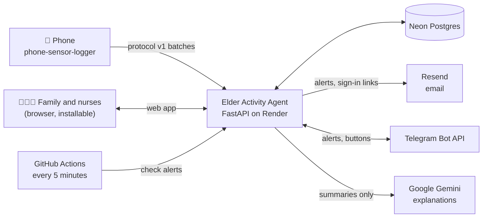
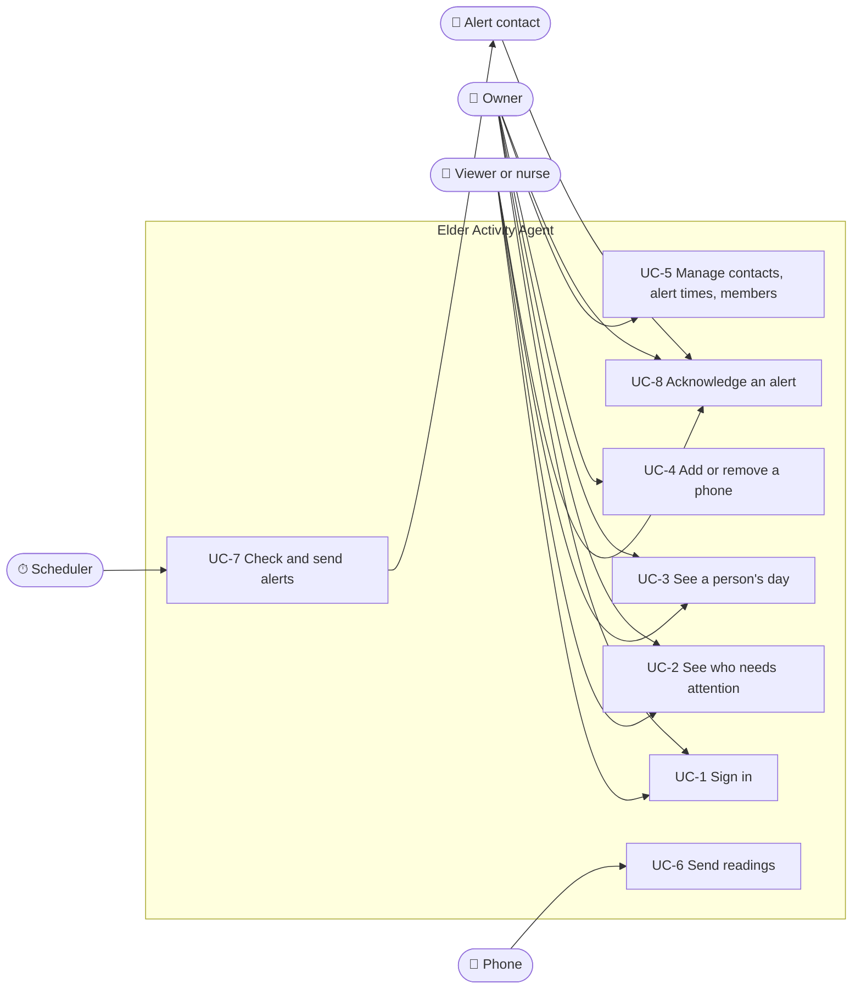
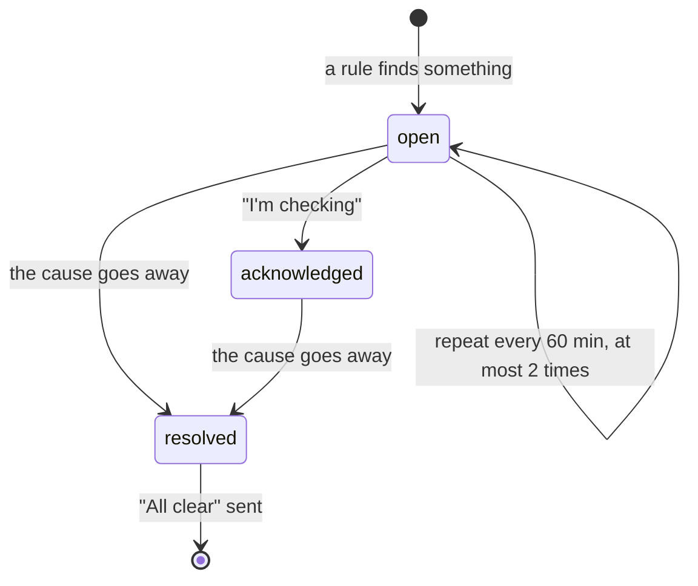
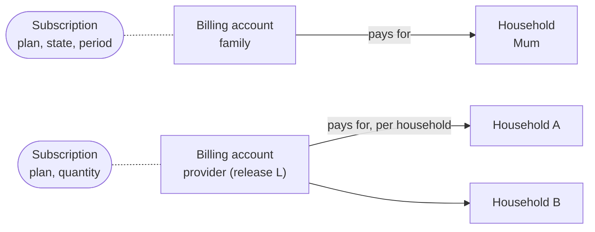

# Software Requirements Specification: elder-activity-agent

| | |
|---|---|
| **Document version** | 1.1 |
| **Status** | Working version (W1) implemented; Phases 2 to 5, billing and reviews, and care teams are a baseline that will be refined |
| **Date** | 2026-11-24 |
| **Owner** | Ambi |
| **Structure** | Based on ISO/IEC/IEEE 29148:2018, tailored for an agile project; the same conventions as phone-sensor-logger's SRS |

## 1. Introduction

### 1.1 Purpose

This document states what elder-activity-agent must do and how well. It is the reference for design, implementation, testing and acceptance. It is a living document: it changes through pull requests, and every requirement links to the stories that build it and the tests that check it ([traceability matrix](traceability.md)).

### 1.2 Scope

elder-activity-agent is a server and web app that:

- receives activity data from phones running phone-sensor-logger (protocol v1);
- decides with fixed rules when a person may need checking on, and alerts their family or carers by email or Telegram, with a plain-words explanation;
- gives families and nurses a web app to see who needs attention, each person's day, and to manage phones, contacts, alert times and members;
- later, charges families a subscription paid on the website, and collects families' reviews that they allow to be shown (release B); care providers pay later still (release L).

Out of scope: medical diagnosis or advice, emergency response, location tracking, and the phone app itself (phone-sensor-logger has its own SRS). The service is a wellness aid, not a medical device (ADR 0002).

### 1.3 Definitions

| Term | Meaning |
|---|---|
| Activity | Steps increasing, the screen turning on or off, or the phone detecting walking, running or cycling |
| Alert | A record that a rule found something; it is open, acknowledged or resolved |
| Alert contact | Someone who receives alerts for a household by email or Telegram, after confirming |
| Billing account | Who pays: a family (usually for one household) or, later, a care provider (for many). Each household belongs to one billing account (ADR 0030) |
| Batch | One upload of readings and summaries from a phone, defined by protocol v1 |
| Care overview | The page listing everyone a user looks after, needs attention first (ADR 0028) |
| Household | The unit of sharing: one or more people, their phones, contacts and members |
| Member | A user with access to a household, as **owner** (may change things) or **viewer** (may look and acknowledge) |
| Person | Someone being looked after. They carry the phone and never sign in. |
| Plan | What a billing account pays for and what its households can use; plans and prices are settings |
| Phone, device | A phone paired with a person; **pending** until its first upload, then **active**, or **revoked** when removed |
| Review | A member's star rating and comment about the service, with their choices about where it may be shown |
| Rule | A deterministic check that decides when to alert (ADR 0026) |
| User | Someone who signs in to the web app: a family member or a nurse |
| Trial | The free period a new household gets before a subscription is needed |
| Waking hours | The local times between which no-activity alerts may be raised for a person |

### 1.4 References

- Architecture: [`docs/architecture.md`](../architecture.md) (C4 diagrams, data model, sequences)
- Decisions: [`docs/adr/`](../adr/README.md), especially ADR 0002 (wellness, not medical), 0011 (per-device tokens), 0020 (rate limits), 0022 (data minimisation), 0023 (protocol v1), 0024 (households and pairing), 0025 (web app), 0026 (rules decide, the LLM explains), 0028 (access by person and care overview), 0030 (billing accounts and payment on the web)
- Stories: [`docs/backlog/working-version.md`](../backlog/working-version.md)
- Protocol: [`protocol/phone-sensor-logger-v1/v1.md`](../../protocol/phone-sensor-logger-v1/v1.md)
- Security: [`docs/security/threat-model.md`](../security/threat-model.md)
- Design: [`docs/design.md`](../design.md); clickable prototype in [`docs/prototype/`](../prototype/README.md)
- Roadmap: [`docs/ROADMAP.md`](../ROADMAP.md)
- Settings: [`config/settings.toml`](../../config/settings.toml) (every value is named in this document as `section.key`)

### 1.5 Conventions

- **Requirement IDs** have the form `EA-<kind>-<area>-<number>`: `FR` for functional, `NFR` for non-functional. IDs are never reused, even when a requirement is deleted.
- **"shall"** marks a mandatory statement. Requirements follow EARS patterns: *always* ("The service shall"), *event* ("When"), *state* ("While"), *unwanted behaviour* ("If ... then") and *optional feature* ("Where").
- **Priority** uses MoSCoW. **Release** is W1 (the working version, steps A to D), P2 to P5 (Phases 2 to 5), B (billing and reviews, families) or L (later: care organisations, including provider billing); see section 6.
- **Stories** names the backlog stories that build a requirement; `-` means none yet.
- **Verification**: T = test, D = demonstration, I = inspection, A = analysis.
- **Status**: Proposed, Approved, Implemented, Verified.
- Numbers that can change (limits, times) are settings; a requirement names the setting and its value when written. **The setting is the source of truth.**
- **Diagrams** are Mermaid and explanatory. **If a diagram and a written requirement disagree, the written requirement applies.**

## 2. Overall description

### 2.1 Product perspective

The service is one of two products. phone-sensor-logger is a generic Android app that knows nothing about this service; it uploads to any receiver implementing protocol v1. This service is such a receiver.

### 2.2 Product functions

- Receive and store phone data safely and once (section 3.2).
- Pair phones with people in households (3.3).
- Decide with rules when to alert (3.4), and run the alert lifecycle (3.5) with plain-words explanations (3.6) to confirmed contacts (3.7).
- Let users sign in by email link (3.8) and see exactly the people they look after (3.9): the care overview and each person's day (3.10).
- Let owners manage phones, alert times, contacts, members and people (3.11), under the configured brand (3.12).
- Be operable from configuration and the command line (3.13).
- Later: daily features, a personal baseline, summaries and questions (3.14), care teams (3.15), billing (3.16) and reviews (3.17).

### 2.3 User classes

| Class | Who | Uses | Frequency |
|---|---|---|---|
| Person | The older person carrying the phone | Nothing in this service; the phone uploads | Continuous |
| Owner | A family member who manages a household | Web app: everything for their households, and paying for them (release B) | Daily to weekly |
| Viewer | Another family member or a carer | Web app: looks and acknowledges | When alerted, or daily |
| Nurse | Looks after several people in several households (ADR 0028) | Web app: the care overview first | Every shift |
| Alert contact | Anyone told about alerts, often also a member | Email or Telegram | When alerted |
| Provider billing admin | Someone at a care provider who manages its bill (release L) | Web app: billing only; seeing people needs care team access (3.15) | Monthly |
| Developer | Builds and runs the service | Command line, CI, hosting | As needed |

### 2.4 Operating environment

- Python 3.12 (ADR 0027), FastAPI, server-rendered HTML; one container on Render's free plan.
- PostgreSQL 16 on Neon's free plan.
- Browsers: current Chrome on Android and Safari on iOS, and current desktop browsers.
- Scheduled checks from GitHub Actions; email by Resend; Telegram Bot API; Google Gemini for explanations.

### 2.5 Constraints

- Free tiers only while testing (Render, Neon, Resend, Gemini, GitHub Actions on a public repository).
- No secrets in the repository, logs, screenshots or documentation; secrets come from environment variables only.
- Health information is "sensitive information" under Australia's Privacy Act; data is minimised (ADR 0022) and legal advice is needed before professional use (ADR 0028).
- The service is not a medical device and not an emergency service, and says so (ADR 0002). Marketing and plan descriptions use the same wording.
- Before taking real payments: an ABN, GST registration once required, terms, a privacy policy and a refund policy, and the wording checked by a lawyer (section 6). Card payments are handled only by Stripe (ADR 0030).
- Reviews follow Australian Consumer Law and Google Play's rules: genuine, never rewarded, and never removed for being negative (3.17).

### 2.6 Assumptions and dependencies

- The phone runs phone-sensor-logger with an activity profile and uploads at least every 15 minutes while it has a connection.
- The free Render instance sleeps when idle; the 5-minute check keeps it mostly awake, and phones retry when it is waking.
- Email reaches only the Resend account's own address until a sending domain is verified (before real users, section 6).

## 3. Functional requirements

### 3.1 Use cases

| Use case | Main flow | Requirements |
|---|---|---|
| UC-1 Sign in | Enter email → receive link → press Sign in → start page | EA-FR-AUTH-001 to 008 |
| UC-2 See who needs attention | Overview: red, amber, green, grey; open a person | EA-FR-VIEW-001 to 004 |
| UC-3 See a person's day | Status, today's numbers, steps by hour; past days | EA-FR-VIEW-005 to 008 |
| UC-4 Add or remove a phone | Name it → setup code shown once → phone connects; or Remove | EA-FR-HH-003 to 006, EA-FR-MAN-001 |
| UC-5 Manage | Alert times, contacts, members, add a person, profile | EA-FR-MAN-002 to 007, EA-FR-CON-001 to 004 |
| UC-6 Send readings | Phone posts a batch → stored once → answer | EA-FR-ING-001 to 010 |
| UC-7 Check and send alerts | Every 5 minutes: rules → open, deliver, repeat, resolve | EA-FR-RUL-001 to 005, EA-FR-ALR-001 to 009, EA-FR-EXP-001 to 003 |
| UC-8 Acknowledge | "I'm checking" by email link, Telegram button or web | EA-FR-ALR-005 |

### 3.2 Ingestion (ING)

#### EA-FR-ING-001 Accept protocol v1 batches

Priority: Must | Release: W1 | Stories: C2b-1 | Verification: T | Status: Implemented

When a phone posts a batch to `POST /v1/readings` with a valid device token in an `Authorization: Bearer` header, the service shall store the batch's readings and minute summaries for that device and answer 200 with the counts stored and ignored.

*Acceptance criteria*

- Given an active phone and a valid batch, when it is posted, then the answer is 200 with `status: "stored"` and the readings appear for that device.

#### EA-FR-ING-002 Refuse unknown tokens

Priority: Must | Release: W1 | Stories: C2b-1 | Verification: T | Status: Implemented

If the token is missing, unknown, revoked, or belongs to a pending phone whose setup time has passed, then the service shall answer 401 with Problem Details and store nothing.

#### EA-FR-ING-003 Reject a bad envelope

Priority: Must | Release: W1 | Stories: C2b-1 | Verification: T | Status: Implemented

If the batch envelope (protocol, session, sequence number, sent time, timezone, readings, summaries) is invalid, then the service shall reject the whole batch with 422 and Problem Details naming the problem.

#### EA-FR-ING-004 Keep good items

Priority: Must | Release: W1 | Stories: C2b-1 | Verification: T | Status: Implemented

When a valid envelope contains invalid items, items for sensors that aren't accepted (`ingest.accepted_sensors`), or items with unknown fields, the service shall ignore only those items, count them in the answer, and store the rest.

*Rationale:* One bad reading never loses a batch, and newer phones keep working (ADR 0023).

#### EA-FR-ING-005 Store each batch once

Priority: Must | Release: W1 | Stories: C2b-1 | Verification: T | Status: Implemented

When a batch with the same device, session and sequence number arrives again, the service shall store nothing new and answer 200 with `status: "duplicate"`.

*Rationale:* Phones retry after timeouts; retries must be safe.

#### EA-FR-ING-006 Never store location

Priority: Must | Release: W1 | Stories: C2b-1 | Verification: T, I | Status: Implemented

The service shall not store location data, whatever a phone sends.

#### EA-FR-ING-007 Batch limits

Priority: Must | Release: W1 | Stories: C2b-1 | Verification: T | Status: Implemented

If a body is larger than `ingest.max_body_bytes` (1,000,000) or a batch has more than `ingest.max_items_per_batch` (10,000) readings or summaries, then the service shall answer 413. The service shall ignore items timed more than `ingest.max_future_minutes` (5) in the future or more than `ingest.max_reading_age_days` (7) in the past.

#### EA-FR-ING-008 Limit each phone's requests

Priority: Must | Release: W1 | Stories: C2b-2 | Verification: T | Status: Implemented

If one phone sends more than `ingest.batches_per_minute_per_device` (30) batches in a minute, then the service shall answer 429 with a `Retry-After` header and store nothing from the extra batches.

#### EA-FR-ING-009 First upload connects a phone

Priority: Must | Release: W1 | Stories: C3-3 | Verification: T | Status: Implemented

When a pending phone's first batch is accepted, the service shall make the phone active, so its token keeps working after the setup time.

#### EA-FR-ING-010 Storage unavailable

Priority: Must | Release: W1 | Stories: C2b-1 | Verification: I | Status: Implemented

If the database can't store a batch, then the service shall answer 503 so the phone retries later, and shall not answer 200.

### 3.3 Households, people and phones (HH)

#### EA-FR-HH-001 Create a household and person

Priority: Must | Release: W1 | Stories: A-2, C3-2 | Verification: T | Status: Implemented

The service shall let a developer (command line) or a user (web app) create a household with a person in it, with the person's display name and timezone.

#### EA-FR-HH-002 Valid names and timezones

Priority: Must | Release: W1 | Stories: A-2, C3-2 | Verification: T | Status: Implemented

If a person's name is empty or longer than 60 characters, or the timezone isn't a valid IANA name, then the service shall refuse it and say why.

#### EA-FR-HH-003 Add a phone with a one-time setup code

Priority: Must | Release: W1 | Stories: A-2, C3-3 | Verification: T | Status: Implemented

When a phone is added for a person, the service shall create a pending phone with a new token and show its setup details once, as a QR code and as text, following phone-sensor-logger's provisioning format with the profile `pairing.device_profile` (`activity`).

#### EA-FR-HH-004 Setup codes expire

Priority: Must | Release: W1 | Stories: C3-3 | Verification: T | Status: Implemented

If a pending phone hasn't uploaded within `pairing.pending_token_expiry_minutes` (30) of being added, then its token shall stop working.

#### EA-FR-HH-005 Tokens are stored as hashes

Priority: Must | Release: W1 | Stories: A-2, C3-3 | Verification: T, I | Status: Implemented

The service shall store only a hash of each phone token, never the token.

#### EA-FR-HH-006 Remove a phone

Priority: Must | Release: W1 | Stories: A-2, C3-3 | Verification: T | Status: Implemented

When a phone is removed, the service shall make its token stop working at once and keep the data it already sent.

### 3.4 Alert rules (RUL)

#### EA-FR-RUL-001 No activity during waking hours

Priority: Must | Release: W1 | Stories: E-1 | Verification: T | Status: Implemented

While it is within a person's waking hours, when the data their phones have sent shows no activity for the person's inactive hours (default `alerts.default_inactive_hours`, 4), the service shall find an `inactivity` alert.

#### EA-FR-RUL-002 What counts as activity

Priority: Must | Release: W1 | Stories: E-1 | Verification: T | Status: Implemented

The service shall count as activity: steps increasing, the screen turning on or off, and the phone detecting walking, running or cycling.

#### EA-FR-RUL-003 Phone silent

Priority: Must | Release: W1 | Stories: E-2 | Verification: T | Status: Implemented

When a person's active phones have sent nothing for the person's silent hours (default `alerts.default_silent_hours`, 6), at any time of day, the service shall find a `phone_silent` alert, worded as a phone problem rather than a concern about the person.

#### EA-FR-RUL-004 Only reported data counts

Priority: Must | Release: W1 | Stories: E-1, E-2 | Verification: T | Status: Implemented

The service shall judge inactivity only from data the phone has sent, so a phone that is slow to upload causes, at most, a phone-silent alert and never an inactivity alert by itself.

#### EA-FR-RUL-005 Alert times per person

Priority: Must | Release: W1 | Stories: E-5 | Verification: T | Status: Implemented

The service shall keep for each person: waking hours (default `alerts.default_waking_from` 08:00 to `alerts.default_waking_to` 21:00, not crossing midnight), inactive hours (1 to 12) and silent hours (1 to 48), and shall refuse other values with a reason.

### 3.5 Alert lifecycle (ALR)

#### EA-FR-ALR-001 Scheduled check

Priority: Must | Release: W1 | Stories: E-1, E-2 | Verification: T | Status: Implemented

When `POST /jobs/check-alerts` is called with the `JOBS_TOKEN` secret, the service shall check every person with an active phone; if the secret is missing or wrong, then it shall answer 401 and check nothing. A scheduler shall call it every 5 minutes.

#### EA-FR-ALR-002 One alert at a time

Priority: Must | Release: W1 | Stories: E-1, E-2 | Verification: T | Status: Implemented

The service shall keep at most one unresolved alert per person and rule.

#### EA-FR-ALR-003 Deliver to confirmed contacts

Priority: Must | Release: W1 | Stories: E-1, E-2 | Verification: T | Status: Implemented

When an alert opens, the service shall send it to every confirmed contact of the person's household, with an "I'm checking" button or link. While a contact is in their quiet hours, the service shall hold their message and send it after the quiet hours end.

#### EA-FR-ALR-004 Repeat until someone is checking

Priority: Must | Release: W1 | Stories: E-1 | Verification: T | Status: Implemented

While an alert is open and unacknowledged, the service shall send it again every `alerts.resend_after_minutes` (60), at most `alerts.max_resends` (2) times.

#### EA-FR-ALR-005 Acknowledge

Priority: Must | Release: W1 | Stories: E-3 | Verification: T | Status: Implemented

When someone presses "I'm checking" (email link, Telegram button or web app), the service shall record who and when, tell every contact who is checking, and stop the repeats. When an alert is already acknowledged, pressing again shall change nothing and send nothing.

#### EA-FR-ALR-006 All clear

Priority: Must | Release: W1 | Stories: E-1, E-2 | Verification: T | Status: Implemented

When the cause of an alert goes away (activity resumes, or the phone sends data), the service shall resolve the alert and tell the contacts who were sent it.

#### EA-FR-ALR-007 Record every message

Priority: Must | Release: W1 | Stories: E-1, E-3 | Verification: T | Status: Implemented

The service shall record every alert message it sends or fails to send, with the contact, kind and result.

#### EA-FR-ALR-008 One person's problem stays theirs

Priority: Must | Release: W1 | Stories: E-1 | Verification: T | Status: Implemented

If checking or alerting for one person fails, then the service shall still check and alert for everyone else.

#### EA-FR-ALR-009 Retry failed sends

Priority: Should | Release: W1 | Stories: E-1 | Verification: T | Status: Implemented

If sending an alert to a contact fails, then the service shall try again at the next checks, up to 6 failures per contact and alert.

### 3.6 Explanations (EXP)

#### EA-FR-EXP-001 Explain in plain words

Priority: Should | Release: W1 | Stories: E-4 | Verification: T | Status: Implemented

When an alert opens, the service shall add one or two plain sentences describing what the data shows, written by the LLM from activity summaries only: no names, contact details or raw readings.

#### EA-FR-EXP-002 Never wait for the LLM

Priority: Must | Release: W1 | Stories: E-4 | Verification: T | Status: Implemented

If the LLM is not configured, fails, or takes longer than `alerts.llm_timeout_seconds` (10), then the service shall use a fixed template, so an alert is never delayed or lost.

*Rationale:* Rules decide; the LLM only explains (ADR 0026).

#### EA-FR-EXP-003 Say who wrote it

Priority: Should | Release: W1 | Stories: E-4 | Verification: I, D | Status: Implemented

Where an explanation was written by the LLM, the web app shall say so.

### 3.7 Alert contacts (CON)

#### EA-FR-CON-001 Contacts per household

Priority: Must | Release: W1 | Stories: C-1, D-3 | Verification: T | Status: Implemented

The service shall keep each household's alert contacts, each with a name and a channel: email (with an address) or Telegram (where `telegram.bot_username` is set).

#### EA-FR-CON-002 Confirm before alerts

Priority: Must | Release: W1 | Stories: C-1, D-3 | Verification: T | Status: Implemented

The service shall send alerts only to contacts who confirmed with a one-time link (email) or by pressing Start (Telegram) within `alerts.link_expiry_minutes` (30).

*Rationale:* Nobody receives health-related alerts by someone else's typing mistake.

#### EA-FR-CON-003 Quiet hours

Priority: Should | Release: W1 | Stories: C-1 | Verification: T | Status: Implemented

The service shall let each contact have quiet hours, in the person's timezone, during which alerts to them wait.

#### EA-FR-CON-004 Remove a contact

Priority: Must | Release: W1 | Stories: C-1, D-3 | Verification: T | Status: Implemented

When a contact is removed, the service shall send them no further alerts.

#### EA-FR-CON-005 Verified Telegram updates

Priority: Must | Release: W1 | Stories: C-1, E-3 | Verification: T | Status: Implemented

If a request to `POST /telegram/webhook` doesn't carry the `TELEGRAM_WEBHOOK_SECRET`, then the service shall ignore it.

#### EA-FR-CON-006 Channels not set up

Priority: Should | Release: W1 | Stories: C-1 | Verification: T | Status: Implemented

Where a channel has no credentials (no Resend key or Telegram bot token), the service shall log that a message would have been sent, without its secret links, instead of failing.

### 3.8 Sign-in and sessions (AUTH)

#### EA-FR-AUTH-001 Sign in by emailed link

Priority: Must | Release: W1 | Stories: C3-1 | Verification: T | Status: Implemented

When a user enters their email address, the service shall email them a sign-in link that works once, for `web.signin_link_minutes` (15). There are no passwords.

#### EA-FR-AUTH-002 Don't reveal who has an account

Priority: Must | Release: W1 | Stories: C3-1 | Verification: T | Status: Implemented

The service shall show the same page, in the same time, whether or not an address has an account, and shall send no email to an address without one.

#### EA-FR-AUTH-003 Opening a link doesn't use it

Priority: Must | Release: W1 | Stories: C3-1 | Verification: T | Status: Implemented

When a sign-in link is opened, the service shall show a "Sign in" button and use the link only when the button is pressed.

*Rationale:* Email security scanners open links by themselves.

#### EA-FR-AUTH-004 Limit sign-in requests

Priority: Must | Release: W1 | Stories: C3-1 | Verification: T | Status: Implemented

The service shall send at most `web.signin_emails_per_hour` (5) sign-in emails to one address per hour, and if one network sends more than `web.signin_requests_per_hour_per_ip` (30) requests in an hour, then answer 429.

#### EA-FR-AUTH-005 Sessions

Priority: Must | Release: W1 | Stories: C3-1 | Verification: T | Status: Implemented

When a link is used, the service shall start a server-side session lasting `web.session_days` (30), in a `__Host-` cookie that is Secure, HttpOnly and SameSite=Lax, storing only a hash of its id.

#### EA-FR-AUTH-006 Sign out

Priority: Must | Release: W1 | Stories: C3-1 | Verification: T | Status: Implemented

When a user signs out, the service shall end the session at once, so its cookie no longer works anywhere.

#### EA-FR-AUTH-007 Forms only from this site

Priority: Must | Release: W1 | Stories: C3-1 | Verification: T | Status: Implemented

If a form is submitted without the session's CSRF token, or from another site, then the service shall refuse it with 403 and change nothing.

#### EA-FR-AUTH-008 Invite only while testing

Priority: Must | Release: W1 | Stories: C3-1, C3-4 | Verification: T | Status: Implemented

The service shall let only existing users sign in; users are created by an owner's invitation or by the developer's command line.

### 3.9 Access (ACC)

#### EA-FR-ACC-001 The set of people

Priority: Must | Release: W1 | Stories: C3-5, D-5 | Verification: T | Status: Implemented

The service shall let a user see every person in every household they are a member of, and no one else (ADR 0028).

#### EA-FR-ACC-002 Not found means not yours

Priority: Must | Release: W1 | Stories: C3-5 | Verification: T | Status: Implemented

If a user asks for a person, alert, phone, contact or member outside their households, then the service shall answer 404, exactly as for something that doesn't exist, and change nothing.

#### EA-FR-ACC-003 Owners change, viewers look

Priority: Must | Release: W1 | Stories: C3-4 | Verification: T | Status: Implemented

The service shall let owners change a household's phones, alert times, contacts and members; viewers may look and acknowledge alerts. If a viewer submits a change, then the service shall refuse it with 403 on the server, and pages shall not offer viewers the forms.

#### EA-FR-ACC-004 Removal works at once

Priority: Must | Release: W1 | Stories: C3-4 | Verification: T | Status: Implemented

When a member is removed, the service shall refuse them that household from their next request.

#### EA-FR-ACC-005 Always an owner

Priority: Must | Release: W1 | Stories: C3-4 | Verification: T | Status: Implemented

If removing a member would leave a household with no owner, then the service shall refuse and say why.

### 3.10 Care overview and a person's day (VIEW)

#### EA-FR-VIEW-001 Status in colour, icon and words

Priority: Must | Release: W1 | Stories: D-5 | Verification: T | Status: Implemented

The service shall show each person's status from their unresolved alerts: **Needs attention** (red; no-activity alert), **Phone not sending** (amber; phone-silent alert), **All OK** (green) or **No phone yet** (grey), each with an icon and words as well as a colour.

#### EA-FR-VIEW-002 Attention first

Priority: Must | Release: W1 | Stories: D-5 | Verification: T | Status: Implemented

The care overview shall list red, then amber, then green, then grey; within red and amber the longest-running alert first; within green the most recently active first; with a count of each.

#### EA-FR-VIEW-003 One person, straight to their day

Priority: Should | Release: W1 | Stories: D-5 | Verification: T | Status: Implemented

When a user who looks after exactly one person opens the app, the service shall show that person's day instead of the overview.

#### EA-FR-VIEW-004 The overview stays current

Priority: Should | Release: W1 | Stories: D-5 | Verification: T, D | Status: Implemented

While the care overview is open and visible, it shall refresh itself every `web.overview_refresh_seconds` (60) and announce changes to screen readers.

#### EA-FR-VIEW-005 Today at a glance

Priority: Must | Release: W1 | Stories: D-1 | Verification: T | Status: Implemented

A person's day shall show, first, any alert and its reason, then when they were last active, steps today, active hours today, phone battery, and when the phone last sent data.

#### EA-FR-VIEW-006 Phone problems shown apart

Priority: Must | Release: W1 | Stories: D-1 | Verification: T | Status: Implemented

If the phone hasn't sent data for over an hour, then the day page shall say so beside the phone's details, as a phone problem, apart from the person's activity.

#### EA-FR-VIEW-007 Steps by hour, readable by everyone

Priority: Must | Release: W1 | Stories: D-1, D-2 | Verification: T | Status: Implemented

The service shall show steps by local hour as a chart and, for the same numbers, a table.

#### EA-FR-VIEW-008 Past days

Priority: Should | Release: W1 | Stories: D-2 | Verification: T | Status: Implemented

The service shall offer today and the six days before it, each with steps and active hours and its own page by hour; older days answer 404.

#### EA-FR-VIEW-009 No location, ever

Priority: Must | Release: W1 | Stories: D-1 | Verification: T, I | Status: Implemented

The web app shall not show any location information.

### 3.11 Managing a household (MAN)

#### EA-FR-MAN-001 Add a phone from the web app

Priority: Must | Release: W1 | Stories: C3-3 | Verification: T | Status: Implemented

When an owner adds a phone, the web app shall show its setup code once, never cached, and say when the phone connects or the code expires.

#### EA-FR-MAN-002 Alert times from the web app

Priority: Must | Release: W1 | Stories: E-5 | Verification: T | Status: Implemented

The web app shall let owners change a person's waking hours, inactive hours and silent hours, and show viewers the values.

#### EA-FR-MAN-003 Contacts from the web app

Priority: Must | Release: W1 | Stories: D-3 | Verification: T | Status: Implemented

The web app shall list a household's contacts with whether they confirmed, and let owners add one (sending the confirmation) and remove one.

#### EA-FR-MAN-004 Invite a member

Priority: Must | Release: W1 | Stories: C3-4 | Verification: T | Status: Implemented

When an owner invites someone by email as owner or viewer, the service shall make them a member and email them a sign-in link that works once, for `web.invite_link_hours` (72).

#### EA-FR-MAN-005 Remove a member

Priority: Must | Release: W1 | Stories: C3-4 | Verification: T | Status: Implemented

The web app shall let owners remove members, including themselves, subject to EA-FR-ACC-005.

#### EA-FR-MAN-006 Add a person

Priority: Must | Release: W1 | Stories: C3-2 | Verification: T | Status: Implemented

The web app shall let a user add a person in a new household, of which they become the owner, or in a household they own.

#### EA-FR-MAN-007 Profile

Priority: Could | Release: W1 | Stories: C3-4 | Verification: T | Status: Implemented

The web app shall let a user change the name others see, for example in "Daughter is checking".

### 3.12 Brand and installing (BRD)

#### EA-FR-BRD-001 Brand from configuration

Priority: Must | Release: W1 | Stories: D-4 | Verification: T, I | Status: Implemented

The service shall take the company name, website, logo, product name and colours only from `config/brand.toml`, and refuse to start if a value is wrong, naming it.

#### EA-FR-BRD-002 Brand colours are readable

Priority: Must | Release: W1 | Stories: D-4 | Verification: T | Status: Implemented

If a brand colour pair fails WCAG 2.2 AA contrast, then the build shall fail, naming the pair.

#### EA-FR-BRD-003 Installable on a phone

Priority: Should | Release: W1 | Stories: C3-6 | Verification: T, D | Status: Implemented

The web app shall provide a web app manifest and icons, so it can be added to a phone's home screen and open full screen.

### 3.13 Configuration and operations (OPS)

#### EA-FR-OPS-001 Typed, documented settings

Priority: Must | Release: W1 | Stories: A-1 | Verification: T | Status: Implemented

The service shall read its settings from `config/settings.toml`, each documented in the file, and refuse to start if a value is missing, unknown or out of range, naming it as `section.key`.

#### EA-FR-OPS-002 Settings from the environment

Priority: Must | Release: W1 | Stories: A-1 | Verification: T | Status: Implemented

Where an environment variable `SECTION__KEY` is set, the service shall use its value instead of the file's.

#### EA-FR-OPS-003 Health checks

Priority: Must | Release: W1 | Stories: - | Verification: T | Status: Implemented

The service shall answer `GET /health` while running and `GET /health/db` with whether the database answers.

#### EA-FR-OPS-004 Command-line administration

Priority: Must | Release: W1 | Stories: A-2, C-1 | Verification: D | Status: Implemented

The service shall provide `scripts/household.py` to create households and people, add and remove phones, contacts and members, change alert times, print a sign-in link for testing, and show a user's households.

#### EA-FR-OPS-005 Simulated phone

Priority: Should | Release: W1 | Stories: E-1 | Verification: D | Status: Implemented

The service shall provide `scripts/simulate_phone.py`, which sends protocol v1 batches with a real device token, so alerts can be tried without the phone app.

### 3.14 Later phases (P2 to P5)

#### EA-FR-FEAT-001 Daily activity features

Priority: Should | Release: P2 | Stories: - | Verification: T | Status: Proposed

The service shall work out for each person and day: wake time, active minutes and the longest inactive period during waking hours.

#### EA-FR-BASE-001 Personal baseline

Priority: Should | Release: P3 | Stories: - | Verification: T, A | Status: Proposed

The service shall learn each person's usual pattern from at least 14 days of features, and tell family when the baseline is ready.

#### EA-FR-BASE-002 Rules from the baseline

Priority: Should | Release: P3 | Stories: - | Verification: T | Status: Proposed

When a day differs clearly from a person's baseline (for example, much later waking), the service shall alert, through the same lifecycle, with scenario tests for each new rule.

#### EA-FR-SUM-001 Daily summary

Priority: Could | Release: P4 | Stories: - | Verification: T, D | Status: Proposed

Where a member asks for it, the service shall send a short daily summary of each person's day, written from features only.

#### EA-FR-SUM-002 Questions about the day

Priority: Could | Release: P4 | Stories: - | Verification: T, D | Status: Proposed

The web app shall let members ask questions about a person's recent days, answered by the agent from features and summaries only, never raw readings, and saying when it doesn't know.

#### EA-FR-OPS-006 Retention

Priority: Must | Release: P5 | Stories: - | Verification: T | Status: Proposed

The service shall delete readings and minute summaries older than the retention period (ADR 0022) every day, and keep only features after that.

#### EA-FR-OPS-007 Monitoring

Priority: Should | Release: P5 | Stories: - | Verification: D | Status: Proposed

If the scheduled check hasn't run for 15 minutes, or fails three times in a row, then the developer shall be told.

#### EA-FR-AUTH-009 Verified sending domain

Priority: Must | Release: P5 | Stories: - | Verification: D | Status: Proposed

Before real users, the service shall send email from a verified domain, so sign-in links, invitations and alerts reach any address.

#### EA-FR-ACC-006 Audit log

Priority: Must | Release: P5 | Stories: - | Verification: T | Status: Proposed

The service shall record who changed a household's phones, alert times, contacts and members, and when, and show owners the record.

### 3.15 Care organisations (L)

These requirements record a use case raised on 2026-11-24: several nurses, in shifts, sharing a group of people. They are **Proposed** for a release after the test with a real family, when a first care organisation wants to try the service, and after legal advice (ADR 0028). Every access check already goes through `app/access.py`, so teams add a source of membership without changing pages.

#### EA-FR-TEAM-001 Care teams

Priority: Should | Release: L | Stories: - | Verification: T | Status: Proposed

The service shall let a care organisation have care teams, each with a team lead and nurses; one nurse may belong to several teams.

#### EA-FR-TEAM-002 The family grants access

Priority: Must | Release: L | Stories: - | Verification: T | Status: Proposed

When a household owner grants a care team access to their household, every nurse in the team shall see that household's people; when the owner withdraws it, none shall from their next request.

#### EA-FR-TEAM-003 One change for a nurse joining or leaving

Priority: Must | Release: L | Stories: - | Verification: T | Status: Proposed

When a team lead adds or removes a nurse, the service shall give or withdraw access to every household the team covers, in one step.

#### EA-FR-TEAM-004 Individual accountability

Priority: Must | Release: L | Stories: - | Verification: T | Status: Proposed

When a nurse acknowledges an alert, the service shall record and announce the individual nurse, not only the team.

#### EA-FR-TEAM-005 Alerts to whoever is on shift

Priority: Should | Release: L | Stories: - | Verification: T | Status: Proposed

Where a care team has an on-duty rota or shared contact, the service shall send its alerts to the nurses on duty rather than to every nurse.

#### EA-FR-TEAM-006 Handover notes

Priority: Could | Release: L | Stories: - | Verification: D | Status: Proposed

The web app shall let nurses leave a note on a person for the next shift.

### 3.16 Billing (BIL)

These requirements record the decision of 2026-11-24 to charge **families** first, by a subscription paid on the website, and **care providers** later, once families have written reviews. They are **Proposed**: families are billed in release B, after Phase 5's test with a real family; providers in release L, with care teams. Payment is taken by Stripe's hosted pages; the phone app sells nothing (ADR 0030).

#### EA-FR-BIL-001 Every household has a billing account

Priority: Must | Release: B | Stories: - | Verification: T | Status: Proposed

The service shall link each household to exactly one billing account; a new household shall get a family billing account of its own unless an owner adds it to one they already pay for.

#### EA-FR-BIL-002 Free trial

Priority: Must | Release: B | Stories: - | Verification: T | Status: Proposed

When a household is created, the service shall give it a free trial of `billing.trial_days` (30 days) without asking for payment details.

#### EA-FR-BIL-003 Pay on the website, through Stripe

Priority: Must | Release: B | Stories: - | Verification: T, I | Status: Proposed

The web app shall let an owner start, change and cancel a subscription only through Stripe's hosted checkout and billing portal; the phone app shall offer nothing to buy.

#### EA-FR-BIL-004 Only owners see billing

Priority: Must | Release: B | Stories: - | Verification: T | Status: Proposed

The service shall show and change a family billing account only for owners of the households it pays for; anyone else shall get "not found" (EA-FR-ACC-002).

#### EA-FR-BIL-005 Payment state comes only from Stripe

Priority: Must | Release: B | Stories: - | Verification: T | Status: Proposed

The service shall change a subscription's state only from Stripe webhook events whose signature is valid (EA-NFR-SEC-008); returning from the checkout page shall not by itself mark anything as paid.

#### EA-FR-BIL-006 Each event once

Priority: Must | Release: B | Stories: - | Verification: T | Status: Proposed

When Stripe sends the same event more than once, or events out of order, the service shall apply each event once and end in the state Stripe reports for the subscription.

#### EA-FR-BIL-007 One place decides what a plan allows

Priority: Must | Release: B | Stories: - | Verification: T | Status: Proposed

The service shall decide what a household may use (for example how many people, phones and members) in one function, from its billing account's plan and state, like access is decided in `app/access.py`.

#### EA-FR-BIL-008 Alerts never stop without warning

Priority: Must | Release: B | Stories: - | Verification: T | Status: Proposed

If a trial ends unpaid or a payment fails, then the service shall keep sending alerts for `billing.grace_days` (14 days), email the owners at the start and `billing.grace_warning_days` (3 days) before alerts stop, and afterwards keep the household's data with its pages read-only; nothing shall be deleted for not paying.

#### EA-FR-BIL-009 Plans and prices from settings

Priority: Should | Release: B | Stories: - | Verification: I | Status: Proposed

The service shall read plan names and limits from `config/settings.toml` and Stripe price IDs from the environment, so prices change without code changes.

#### EA-FR-BIL-010 Cancel at any time

Priority: Must | Release: B | Stories: - | Verification: T | Status: Proposed

When an owner cancels, the subscription shall continue to the end of the paid period, and the web app shall say clearly when it ends and what happens then.

#### EA-FR-BIL-011 Provider accounts, priced per household

Priority: Should | Release: L | Stories: - | Verification: T | Status: Proposed

The service shall let a care provider's billing account pay for many households, with the subscription quantity kept equal to the number of households it pays for.

#### EA-FR-BIL-012 A provider takes over paying

Priority: Should | Release: L | Stories: - | Verification: T | Status: Proposed

When an owner agrees to a care provider paying for their household, the service shall move the household to the provider's billing account in one step and end the family's subscription with a pro-rata credit, so no period is paid twice.

#### EA-FR-BIL-013 Invoices for providers

Priority: Could | Release: L | Stories: - | Verification: D | Status: Proposed

Where a care provider chooses, the service shall bill it by invoice paid by bank transfer.

#### EA-FR-BIL-014 Paying doesn't give access

Priority: Must | Release: L | Stories: - | Verification: T | Status: Proposed

The service shall let a provider's billing admins manage only its bill; seeing people shall still need care team access granted by each household's owner (EA-FR-TEAM-002).

### 3.17 Reviews (REV)

Families' reviews will be shown to care providers (release L) and possibly publicly. They are **Proposed** for release B, so genuine reviews have built up before providers are approached. Families are also invited to leave independent reviews on public review sites; that needs no code.

#### EA-FR-REV-001 Leave a review

Priority: Should | Release: B | Stories: - | Verification: T | Status: Proposed

The web app shall let each member leave one review per household: a rating from 1 to 5 stars and an optional comment of up to `reviews.max_comment_chars` (1,000) characters.

#### EA-FR-REV-002 Everyone is asked, once

Priority: Must | Release: B | Stories: - | Verification: T | Status: Proposed

When a member has used the web app for `reviews.ask_after_days` (30 days), the web app shall ask them once for a review; who is asked shall not depend on alerts, ratings or anything suggesting whether they are happy.

#### EA-FR-REV-003 Permission to show, given separately

Priority: Must | Release: B | Stories: - | Verification: T | Status: Proposed

The web app shall ask separately whether a review may be shown to care providers and whether it may be shown publicly, both "no" until the member chooses, and how they are named: first name and suburb, "a family in" a town, or anonymous.

#### EA-FR-REV-004 Change or withdraw at any time

Priority: Must | Release: B | Stories: - | Verification: T | Status: Proposed

When a member changes or withdraws a review or a permission, the service shall show the review according to the change from the next request.

#### EA-FR-REV-005 Genuine reviews are never edited or quietly removed

Priority: Must | Release: B | Stories: - | Verification: T, I | Status: Proposed

The service shall not let anyone but the member edit a review; the developer shall be able only to hide a review that is fake or abusive, and the service shall record who hid it, when and why.

#### EA-FR-REV-006 An honest summary

Priority: Must | Release: B | Stories: - | Verification: T | Status: Proposed

Where reviews are shown to care providers or publicly, the service shall show only reviews with that permission, together with the total number of reviews and the average rating of all reviews that aren't hidden under EA-FR-REV-005.

#### EA-FR-REV-007 No rewards for reviews

Priority: Must | Release: B | Stories: - | Verification: I | Status: Proposed

The service shall offer nothing of value, such as a discount or a longer trial, in return for a review.

### 3.18 Data requirements

| Data | Kept | Where defined |
|---|---|---|
| Readings and minute summaries | 7 days (deletion job in P5, EA-FR-OPS-006) | `migrations/versions/0001_*`, ADR 0022 |
| Households, people, phones (token hashes only) | Until removed | `0002_*`, ADR 0024 |
| Alerts, deliveries, contacts, alert settings | Until the household is deleted | `0003_*`, ADR 0026 |
| Users, members, sign-in links and sessions (hashes only) | Until removed; links and sessions until they expire | `0004_*`, ADR 0025 |
| Billing accounts, subscriptions (Stripe IDs, plan, state; never card details), Stripe event IDs (release B) | Billing records as long as tax law requires; event IDs for `billing.event_days` (30 days) | A later migration, ADR 0030 |
| Reviews and permissions, with the time each was given (release B) | Until the member deletes the review or their account | A later migration |

Location is never stored (EA-FR-ING-006). The data model diagram is in [architecture section 9.6](../architecture.md#96-target-data-model).

## 4. Non-functional requirements

### 4.1 Performance (PERF)

#### EA-NFR-PERF-001 Fast uploads

Priority: Should | Release: P5 | Stories: - | Verification: A | Status: Proposed

While the service is awake, it shall answer 95% of protocol v1 uploads of up to 1,000 items within 1 second.

#### EA-NFR-PERF-002 Alerts within minutes

Priority: Must | Release: W1 | Stories: E-1 | Verification: A, D | Status: Implemented

When a rule's condition becomes true, the service shall send the alert within 10 minutes (two scheduled checks), unless a contact is in quiet hours.

#### EA-NFR-PERF-003 Pages load quickly

Priority: Should | Release: P5 | Stories: - | Verification: A | Status: Proposed

While the service is awake, web app pages shall load within 2 seconds on a 4G phone.

### 4.2 Reliability (REL)

#### EA-NFR-REL-001 Safe retries

Priority: Must | Release: W1 | Stories: C2b-1 | Verification: T | Status: Implemented

Every upload and every alert step shall be safe to repeat: the same batch is stored once (EA-FR-ING-005), an alert opens once (EA-FR-ALR-002), and an acknowledgement counts once (EA-FR-ALR-005).

#### EA-NFR-REL-002 The LLM is never on the critical path

Priority: Must | Release: W1 | Stories: E-4 | Verification: T | Status: Implemented

No upload, alert or page shall depend on the LLM answering (EA-FR-EXP-002).

### 4.3 Security (SEC)

#### EA-NFR-SEC-001 Secrets

Priority: Must | Release: W1 | Stories: A-1 | Verification: I | Status: Implemented

Secrets (database URL, API keys, bot token, jobs token, webhook secret) shall come only from environment variables, never from the repository, and shall never be logged.

#### EA-NFR-SEC-002 Only hashes of credentials

Priority: Must | Release: W1 | Stories: C3-1, C3-3 | Verification: T | Status: Implemented

Phone tokens, sign-in links, contact and alert links, and session ids shall be stored only as hashes.

#### EA-NFR-SEC-003 Browser protections

Priority: Must | Release: W1 | Stories: C3-1 | Verification: T | Status: Implemented

Web app pages shall be sent with a Content Security Policy allowing only the site's own scripts and styles, no framing, `Strict-Transport-Security`, `X-Content-Type-Options: nosniff` and `Cache-Control: no-store`; all text shall be escaped.

#### EA-NFR-SEC-004 No internals in errors

Priority: Must | Release: W1 | Stories: C2b-1 | Verification: T | Status: Implemented

Error answers shall be Problem Details or plain pages without stack traces or internal details.

#### EA-NFR-SEC-005 Checked on every change

Priority: Must | Release: W1 | Stories: - | Verification: I | Status: Implemented

Every pull request shall pass CodeQL and a dependency audit before it can be merged.

#### EA-NFR-SEC-006 Input checks can't be slowed down

Priority: Must | Release: W1 | Stories: C3-1 | Verification: T | Status: Implemented

Checks on text typed into the web app shall take time proportional to its length, whatever is typed.

#### EA-NFR-SEC-007 No card details

Priority: Must | Release: B | Stories: - | Verification: I, T | Status: Proposed

The service shall never receive, log or store card details; it shall keep only Stripe's customer and subscription IDs and what Stripe reports about the subscription.

#### EA-NFR-SEC-008 Billing webhooks are checked

Priority: Must | Release: B | Stories: - | Verification: T | Status: Proposed

The service shall refuse a Stripe webhook request whose signature doesn't match `STRIPE_WEBHOOK_SECRET` or whose timestamp is more than `billing.webhook_tolerance_seconds` (300 seconds) old, and shall log refusals without the request body; `STRIPE_SECRET_KEY` shall come from the environment only (EA-NFR-SEC-001).

### 4.4 Privacy (PRIV)

#### EA-NFR-PRIV-001 Minimal data

Priority: Must | Release: W1 | Stories: C2b-1 | Verification: I | Status: Implemented

The service shall accept only the sensors in `ingest.accepted_sensors` and store no location (ADR 0022).

#### EA-NFR-PRIV-002 Minimal data to the LLM

Priority: Must | Release: W1 | Stories: E-4 | Verification: T, I | Status: Implemented

The service shall send the LLM only activity summaries: no names, contact details or raw readings.

#### EA-NFR-PRIV-003 Wellness, not medical

Priority: Must | Release: W1 | Stories: D-1 | Verification: I | Status: Implemented

The web app shall say that the service is a wellness aid, not a medical device or an emergency service, and to call 000 in an emergency.

#### EA-NFR-PRIV-004 Reviews shown only with permission

Priority: Must | Release: B | Stories: - | Verification: T | Status: Proposed

The service shall record when each review permission was given or withdrawn, and shall show no review, name or suburb anywhere without the matching permission (EA-FR-REV-003).

### 4.5 Usability and accessibility (USE)

#### EA-NFR-USE-001 WCAG 2.2 AA

Priority: Must | Release: W1 | Stories: C3-6 | Verification: I, D | Status: Implemented

The web app shall meet WCAG 2.2 AA: status by colour, icon and words; 48 px touch targets; visible focus; a skip link; form errors named and linked to their fields; status changes announced. Automated checks (axe-core, Lighthouse) are added in P5.

#### EA-NFR-USE-002 Any phone

Priority: Must | Release: W1 | Stories: C3-6 | Verification: D | Status: Implemented

The web app shall work without horizontal scrolling at 320, 375 and 412 px wide and with text at 200%, and in light and dark mode.

#### EA-NFR-USE-003 Works without JavaScript

Priority: Should | Release: W1 | Stories: C3-6 | Verification: D | Status: Implemented

Every page and form shall work without JavaScript; scripts only refresh the overview, report a phone connecting, and close the account menu.

#### EA-NFR-USE-004 Plain language

Priority: Must | Release: W1 | Stories: E-4 | Verification: I | Status: Implemented

Messages and pages shall use plain, short sentences, local times ("9:05 am", "yesterday"), and no technical terms.

### 4.6 Maintainability (MNT)

#### EA-NFR-MNT-001 Checked code

Priority: Must | Release: W1 | Stories: A-1 | Verification: I | Status: Implemented

Every pull request shall pass ruff (with docstring rules), mypy and the tests, against a real PostgreSQL database.

#### EA-NFR-MNT-002 Traceable requirements

Priority: Must | Release: W1 | Stories: - | Verification: T | Status: Implemented

Every implemented requirement verified by test shall name its stories, and at least one test file shall name it; CI shall fail otherwise and keep the [traceability matrix](traceability.md) current.

#### EA-NFR-MNT-003 Recorded decisions

Priority: Must | Release: W1 | Stories: - | Verification: I | Status: Implemented

Each significant decision shall be recorded as an Architecture Decision Record.

### 4.7 Cost (CST)

#### EA-NFR-CST-001 Free while testing

Priority: Must | Release: W1 | Stories: - | Verification: I | Status: Implemented

While testing, the service shall run on free plans only: Render, Neon, Resend, Gemini and GitHub Actions.

#### EA-NFR-CST-002 Stripe in test mode until going live

Priority: Must | Release: B | Stories: - | Verification: I | Status: Proposed

The service shall use Stripe's test mode, which costs nothing, until the business setup in section 2.5 is done; switching to live mode shall need only a change of environment variables.

### 4.8 Compatibility (CMP)

#### EA-NFR-CMP-001 Protocol v1 compatibility

Priority: Must | Release: W1 | Stories: C2b-1 | Verification: T | Status: Implemented

The service shall accept every batch valid under protocol v1, as checked by the protocol's contract tests and examples, and ignore unknown fields.

## 5. External interfaces

### 5.1 User interface

Server-rendered pages, designed in [`docs/design.md`](../design.md) and tried as the [clickable prototype](../prototype/README.md):

| Page | Path | Requirements |
|---|---|---|
| Sign in, check your email, sign-in link | `/signin`, `/signin/link/{token}` | AUTH |
| Care overview | `/people` | VIEW-001 to 004 |
| A person's day, past days | `/people/{id}`, `/people/{id}/days`, `/people/{id}/days/{date}` | VIEW-005 to 009 |
| Phones, add a phone | `/people/{id}/phones`, `/people/{id}/phones/add` | MAN-001, HH |
| Alert times, contacts, members | `/people/{id}/alert-times`, `/contacts`, `/members` | MAN-002 to 005 |
| Alerts, one alert | `/alerts`, `/alerts/{id}` | ALR-005, EXP-003 |
| Settings, profile, add a person, help, about | `/settings`, `/profile`, `/people/add`, `/help`, `/about` | MAN-006, MAN-007, PRIV-003 |
| Billing (release B) | `/billing` | BIL-001 to 010 |
| Reviews (release B) | `/reviews` | REV-001 to 004 |

### 5.2 Software interfaces

| Interface | Direction | Protocol | Authentication |
|---|---|---|---|
| `POST /v1/readings` | Phone → service | protocol v1 JSON | Per-phone bearer token |
| `POST /jobs/check-alerts` | GitHub Actions → service | HTTPS | `JOBS_TOKEN` |
| `POST /telegram/webhook` | Telegram → service | Bot API updates | `TELEGRAM_WEBHOOK_SECRET` header |
| `/contacts/confirm/{token}`, `/a/{token}` | Contact's browser → service | HTML pages with a button | One-time token |
| Resend API | Service → Resend | HTTPS JSON | `RESEND_API_KEY` |
| Telegram Bot API | Service → Telegram | HTTPS JSON | `TELEGRAM_BOT_TOKEN` |
| Gemini API | Service → Google | HTTPS | `GEMINI_API_KEY` |
| Stripe API: checkout, billing portal (release B) | Service → Stripe | HTTPS JSON | `STRIPE_SECRET_KEY` |
| `POST /stripe/webhook` (release B) | Stripe → service | Stripe events | Signature with `STRIPE_WEBHOOK_SECRET` |
| PostgreSQL | Service → Neon | TLS | `DATABASE_URL` |

### 5.3 Communication

All traffic is HTTPS. Times on the wire are UTC; pages and messages show the person's local time.

## 6. Release plan

| Release | Content | Status |
|---|---|---|
| **W1** | The working version: steps A to D ([roadmap](../ROADMAP.md)) | Implemented (2026-11-24) |
| **P2** | Daily activity features | Proposed |
| **P3** | Personal baseline and rules from it | Proposed |
| **P4** | Daily summaries; questions about the day | Proposed |
| **P5** | Scenario testing, monitoring, retention, verified email domain, audit log, automated accessibility checks, test with a real family | Proposed |
| **B** | Billing for families: a trial, then a subscription paid on the website with Stripe (section 3.16), in test mode until the business setup is done; family reviews (3.17) | Proposed |
| **L** | Care organisations and care teams (section 3.15), and care providers paying per household (3.16) | Proposed |

## 7. Traceability

[`traceability.md`](traceability.md) lists every requirement with its stories and the test files that name it (`Verifies:` in each test file's docstring). It is generated by `scripts/check_traceability.py --write`; `tests/test_traceability.py` fails CI if a story is unknown, an implemented requirement verified by test has no test, or the matrix is out of date.

## 8. Change history

| Version | Date | Change |
|---|---|---|
| 1.0 | 2026-11-24 | First version: the working version (W1) as built in steps A to D; Phases 2 to 5 and care teams as Proposed |
| 1.1 | 2026-11-24 | Billing (3.16) and reviews (3.17) added as Proposed: families pay first (release B), care providers later (release L); billing accounts and Stripe decided in ADR 0030; release B added |
