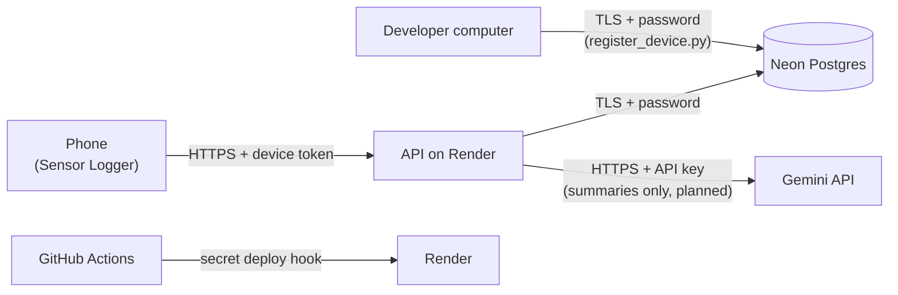

# Threat model

A living document: update it in the same pull request as any change that affects what the system stores, who can reach it, or how it is deployed.

**Last reviewed:** 2026-11-17 (end of Phase 1, Stage B)

## 1. What we are protecting

| Asset | Why it matters |
|---|---|
| **Activity data** (steps, light, battery per minute) | Reveals an older person's routine: when they wake, when they are active, and when they may be alone or unwell. In the wrong hands this is a **physical safety** risk, not only a privacy one. |
| **Device tokens** | Let a phone write data for one device. |
| **Database credentials** (`DATABASE_URL`) | Full read and write access to all data. Neon is reachable from the internet, so the password is the main barrier. |
| **API keys** (`GEMINI_API_KEY`, `APP_API_KEY`) | Gemini quota and access to `/chat` and `/health/db`. |
| **Deployment pipeline** (GitHub, deploy hook, Render) | Whoever controls it can run any code in production. |
| **Developer accounts** (GitHub, Render, Neon, Google) | Control everything above. |

## 2. Who might attack, and how

| Actor | Example |
|---|---|
| Opportunistic internet attacker | Scans for open endpoints, leaked keys and known vulnerable packages. |
| Someone with a lost or stolen phone | Uses the phone's token to send fake data. |
| Malicious or compromised dependency | A package update that steals environment variables. |
| Account takeover | Phished or reused password on GitHub, Render or Neon. |
| Developer mistake | Secrets pasted into chats, logs or commits. **This has already happened** during development (an ingest token and a database password); both were rotated and verified. |

## 3. Trust boundaries

Every arrow crosses the public internet, so every one is encrypted and authenticated.

## 4. Threats and measures

Status: ✅ implemented · 🟡 planned · ⚪ accepted risk (see section 5)

### Spoofing (pretending to be someone else)

| Threat | Measure | Status |
|---|---|---|
| Fake phone sends data | Per-device random tokens (256 bits), checked by hash; unknown tokens get 401 | ✅ |
| Lost phone keeps sending | `register_device.py revoke` disables one device without affecting others | ✅ |
| Token guessed | 256-bit random tokens can't be guessed in practice | ✅ |
| Developer account takeover | Two-factor authentication (ideally passkeys) on GitHub, Render, Neon and Google | 🟡 (manual setting, ADR 0019) |

### Tampering (changing data or code)

| Threat | Measure | Status |
|---|---|---|
| Untested or malicious code reaches production | Protected `main`; changes only through pull requests; CI must pass; Render auto-deploy off | ✅ |
| Malformed or implausible data | Validation, unknown sensors ignored, stale and future timestamps dropped | ✅ |
| Replayed batches double-count data | Batch IDs recorded; repeats skipped | ✅ |
| Vulnerable or malicious dependency | Lockfile, Dependabot, `pip-audit` gate before deploy, CodeQL | ✅ (this PR) |

### Repudiation (denying actions)

| Threat | Measure | Status |
|---|---|---|
| Can't tell which device sent data | Every batch is recorded with its device and time; one log line per batch | ✅ |
| No record of admin actions | Device creation and revocation are timestamped in the database | ✅ |

### Information disclosure (data leaking)

| Threat | Measure | Status |
|---|---|---|
| Tokens in logs or URLs | Tokens only accepted in the `Authorization` header; logs contain counts, never values or tokens | ✅ |
| Database read by an attacker | Only token hashes stored; TLS in transit and AES-256 at rest (Neon) | ✅ |
| Secrets committed to Git | `.env` ignored; GitHub secret scanning and push protection | ✅ / 🟡 (enable in settings) |
| Tests wipe or read production data | Tests refuse to run against Neon; separate throwaway database | ✅ |
| Personal data sent to the LLM or used for training | Only anonymised summaries; Gemini paid tier before real users | 🟡 (ADR 0005) |
| Family members see each other's data | User accounts and per-user authorisation for any dashboard | 🟡 (not built yet) |
| Over-collection | No GPS, microphone or camera; summaries instead of raw data | ✅ |
| Data kept forever, or stored overseas | Retention and residency policy | 🟡 (ADR 0022, proposed) |

### Denial of service

| Threat | Measure | Status |
|---|---|---|
| Huge requests exhaust memory | 1 MB body limit, 10,000 readings per batch | ✅ |
| Flood of requests from one device | Per-device rate limiting | 🟡 (ADR 0020) |
| Strangers keep the database awake (cost) | `/health` never touches the database; `/health/db` needs the API key | ✅ |
| Strangers use up Gemini quota | `/chat` needs the API key | ✅ |

### Elevation of privilege

| Threat | Measure | Status |
|---|---|---|
| Compromised app gets full database control | Separate least-privilege logins for the app and for migrations | 🟡 (ADR 0015, 0019) |
| Compromised container gets root | Container runs as a non-root user | ✅ |

## 5. Accepted risks (for now)

| Risk | Why it's accepted | When to revisit |
|---|---|---|
| Neon is reachable from the whole internet (password only) | IP allowlisting needs a paid plan | Before real users |
| Sensor Logger is third-party software holding a device token | Testing only, on the developer's own phone | Replaced by the native app |
| Gemini free tier may use prompts to improve Google's products | No real users' data is sent | Before real users |
| The API docs page (`/docs`) is public | It reveals the API's shape, not data; all data endpoints need credentials | If the API gains admin endpoints |
| Single developer with full access | Personal project | When others join |

## 6. Incident runbook (short version)

**A secret leaks** (in a chat, log, screenshot or commit):

1. Rotate it immediately at its source (Neon, Google AI Studio, Render, or `register_device.py revoke` for device tokens).
2. Update it everywhere it's used (Render, `.env`, the phone).
3. Verify the old value is rejected (`scripts/check_token.py`, or `/health/db` for the database).
4. If it was committed, rotating is mandatory: deleting the commit doesn't help.

**A phone is lost:** revoke it with `register_device.py revoke`, then register the replacement.

**Suspicious activity** (bursts of 401s, unknown devices in `register_device.py list`): revoke affected devices, rotate `DATABASE_URL`, check Render and Neon access logs, and review recent deploys.
