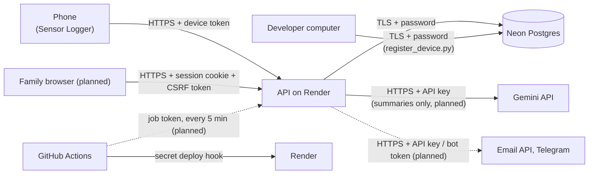

# Threat model

A living document: update it in the same pull request as any change that affects what the system stores, who can reach it, or how it is deployed.

**Last reviewed:** 2026-11-22 (working-version plan added: rows marked 🟡 with a step are designed in ADRs 0023 to 0026 and built in that step of the [roadmap](../ROADMAP.md))

## 1. What we are protecting

| Asset | Why it matters |
|---|---|
| **Activity data** (steps, light, battery per minute) | Reveals an older person's routine: when they wake, when they are active, and when they may be alone or unwell. In the wrong hands this is a **physical safety** risk, not only a privacy one. |
| **Device tokens** | Let a phone write data for one device. |
| **Family accounts and sessions** | A session shows one household's data and, for owners, lets them add phones and contacts. |
| **Alert contacts** (email addresses, Telegram chat ids) | Personal data of family members; also a way to send them convincing fake alerts. |
| **Setup QR codes** | Contain a device token in protocol v1, so a photo of one is a token until it expires or is used. |
| **Database credentials** (`DATABASE_URL`) | Full read and write access to all data. Neon is reachable from the internet, so the password is the main barrier. |
| **API keys** (`GEMINI_API_KEY`, `APP_API_KEY`, `EMAIL_API_KEY`, `TELEGRAM_BOT_TOKEN`, `JOBS_TOKEN`) | Gemini quota; access to `/chat` and `/health/db`; sending email and Telegram messages as the service; running the alert check. |
| **Deployment pipeline** (GitHub, deploy hook, Render) | Whoever controls it can run any code in production. |
| **Developer accounts** (GitHub, Render, Neon, Google) | Control everything above. |

## 2. Who might attack, and how

| Actor | Example |
|---|---|
| Opportunistic internet attacker | Scans for open endpoints, leaked keys and known vulnerable packages. |
| Someone with a lost or stolen phone | Uses the phone's token to send fake data. |
| Malicious or compromised dependency | A package update that steals environment variables. |
| Account takeover | Phished or reused password on GitHub, Render or Neon. |
| Curious or hostile family member | A member of one household tries ids from another, or a former partner keeps a viewer account. |
| Phisher | Sends fake "sign-in" or "alert" messages that look like the service's. |
| Developer mistake | Secrets pasted into chats, logs or commits. **This has already happened** during development (an ingest token and a database password); both were rotated and verified. |

## 3. Trust boundaries

Every arrow crosses the public internet, so every one is encrypted and authenticated.

## 4. Threats and measures

Status: ✅ implemented · 🟡 planned · ⚪ accepted risk (see section 5)

### Spoofing (pretending to be someone else)

| Threat | Measure | Status |
|---|---|---|
| Fake phone sends data | Per-device random tokens (256 bits), checked by hash; unknown tokens get 401 | ✅ |
| Lost phone keeps sending | `register_device.py revoke` disables one device without affecting others | ✅ |
| Token guessed | 256-bit random tokens can't be guessed in practice | ✅ |
| Photographed setup QR code used to send data | Pending tokens expire unless a first batch arrives within `pairing.pending_token_expiry_minutes` (server setting, default 30, allowed 5 to 1440); the owner sees "Phone connected" and can revoke; QR shown once | 🟡 (step A, ADR 0024) |
| Someone signs in as a family member | Email magic links: single-use, 15 minutes, stored as hashes, rate-limited per address and IP; same response for unknown addresses | 🟡 (step D, ADR 0025) |
| Stolen session cookie | `Secure`, `HttpOnly`, `SameSite=Lax`, `__Host-` cookie; server-side sessions that sign-out and owners can revoke; HTTPS only (HSTS) | 🟡 (step D) |
| Fake alerts or sign-in emails (phishing) | Messages never ask for anything; links go only to the service's own domain; SPF, DKIM and DMARC on the sending domain | 🟡 (step C) |
| Someone links their Telegram chat as a contact | One-time Telegram start codes created by an owner, expiring after 30 minutes | 🟡 (step C) |
| Developer account takeover | Two-factor authentication (ideally passkeys) on GitHub, Render, Neon and Google | 🟡 (manual setting, ADR 0019) |

### Tampering (changing data or code)

| Threat | Measure | Status |
|---|---|---|
| Untested or malicious code reaches production | Protected `main`; changes only through pull requests; CI must pass; Render auto-deploy off | ✅ |
| Malformed or implausible data | Validation, unknown sensors ignored, stale and future timestamps dropped | ✅ |
| Replayed batches double-count data | Batch IDs recorded; repeats skipped | ✅ |
| Cross-site request forgery changes settings or contacts | CSRF token on every form and HTMX request; `SameSite=Lax` cookies | 🟡 (step D) |
| Injected script in the web app | Jinja2 auto-escaping; Content Security Policy allowing only the app's own scripts; no inline scripts | 🟡 (step D) |
| Alert check triggered by strangers | `/jobs/check-alerts` needs `JOBS_TOKEN`; repeated calls are harmless (open alerts aren't resent) | 🟡 (step C) |
| Vulnerable or malicious dependency | Lockfile, Dependabot, `pip-audit` gate before deploy, CodeQL | ✅ (this PR) |

### Repudiation (denying actions)

| Threat | Measure | Status |
|---|---|---|
| Can't tell which device sent data | Every batch is recorded with its device and time; one log line per batch | ✅ |
| No record of admin actions | Device creation and revocation are timestamped in the database | ✅ |
| Family member denies changing settings or acknowledging an alert | Audit log of member actions (who, what, when) per household; acknowledgements record the member | 🟡 (steps C, D) |

### Information disclosure (data leaking)

| Threat | Measure | Status |
|---|---|---|
| Tokens in logs or URLs | Tokens only accepted in the `Authorization` header; logs contain counts, never values or tokens | ✅ |
| Database read by an attacker | Only token hashes stored; TLS in transit and AES-256 at rest (Neon) | ✅ |
| Secrets committed to Git | `.env` ignored; GitHub secret scanning and push protection | ✅ / 🟡 (enable in settings) |
| Tests wipe or read production data | Tests refuse to run against Neon; separate throwaway database | ✅ |
| Personal data sent to the LLM or used for training | Only anonymised summaries; Gemini paid tier before real users | 🟡 (ADR 0005) |
| One household sees another's data | All household data read through one scoped-query module; tests check every route returns 404 for another household's ids; row-level security before real users | 🟡 (step D, ADR 0024) |
| Former member keeps access | Owners remove members, which revokes their sessions | 🟡 (step D) |
| Alerts reveal too much in email or Telegram | Messages say what the rule saw and when, never location or raw data; details only in the signed-in app | 🟡 (step C, ADR 0026) |
| Location shown or stored | Phones use the logger's `activity` profile; location readings are ignored and never stored; the web app has no location view | 🟡 (step A, ADR 0023) |
| Personal data in LLM prompts | Prompts contain summaries only, no names, emails or chat ids | 🟡 (step C) |
| Over-collection | No GPS, microphone or camera; summaries instead of raw data | ✅ |
| Data kept forever, or stored overseas | Retention and residency policy | 🟡 (ADR 0022, proposed) |

### Denial of service

| Threat | Measure | Status |
|---|---|---|
| Huge requests exhaust memory | 1 MB body limit, 10,000 readings per batch | ✅ |
| Flood of requests from one device | Per-device rate limiting | 🟡 (step A, ADR 0020) |
| Strangers keep the database awake (cost) | `/health` never touches the database; `/health/db` needs the API key | ✅ |
| Strangers use up Gemini quota | `/chat` needs the API key | ✅ |
| Sign-in link requests used to flood someone's inbox or our email quota | Rate limits per address and per IP | 🟡 (step D) |
| Alert storms when many phones go silent at once (an outage on our side) | Phone-silent alerts paused when most devices stop at the same time; a single developer alert instead | 🟡 (step C) |

### Elevation of privilege

| Threat | Measure | Status |
|---|---|---|
| Compromised app gets full database control | Separate least-privilege logins for the app and for migrations | 🟡 (ADR 0015, 0019) |
| Compromised container gets root | Container runs as a non-root user | ✅ |
| Viewer changes settings or adds phones | Role checked on the server for every change; viewers get 403 | 🟡 (step D) |

## 5. Accepted risks (for now)

| Risk | Why it's accepted | When to revisit |
|---|---|---|
| Neon is reachable from the whole internet (password only) | IP allowlisting needs a paid plan | Before real users |
| Sensor Logger is third-party software holding a device token | Testing only, on the developer's own phone | Replaced by the native app |
| Gemini free tier may use prompts to improve Google's products | No real users' data is sent | Before real users |
| The API docs page (`/docs`) is public | It reveals the API's shape, not data; all data endpoints need credentials | If the API gains admin endpoints |
| Single developer with full access | Personal project | When others join |
| Setup QR code contains the device token (protocol v1) | Short expiry while pending, revocation, consent on the phone | If codes are seen being shared; pairing codes in protocol v2 |
| Alert check timing depends on GitHub's best-effort schedule | Testing only; alerts may be minutes late | Before real users (a real scheduler) |

## 6. Incident runbook (short version)

**A secret leaks** (in a chat, log, screenshot or commit):

1. Rotate it immediately at its source (Neon, Google AI Studio, Render, or `register_device.py revoke` for device tokens).
2. Update it everywhere it's used (Render, `.env`, the phone).
3. Verify the old value is rejected (`scripts/check_token.py`, or `/health/db` for the database).
4. If it was committed, rotating is mandatory: deleting the commit doesn't help.

**A phone is lost:** revoke it (web app Devices page, or `register_device.py revoke`), then add the replacement.

**A family account is compromised:** revoke its sessions and remove it from the household; check the household's audit log for changes to contacts and devices.

**Suspicious activity** (bursts of 401s, unknown devices in `register_device.py list`): revoke affected devices, rotate `DATABASE_URL`, check Render and Neon access logs, and review recent deploys.
