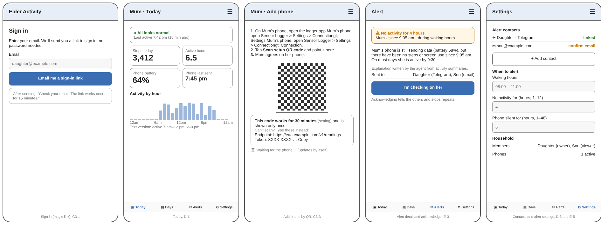
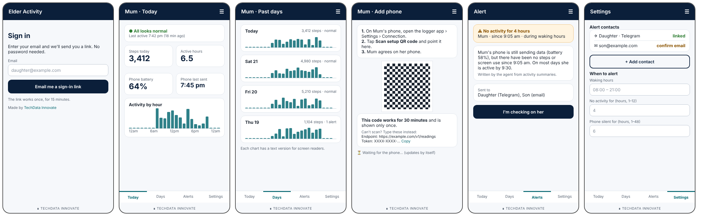
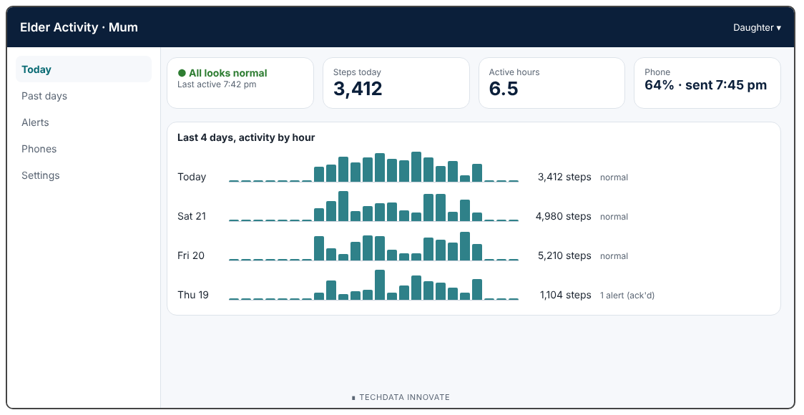

# Wireframes: family and care web app

**Clickable prototype:** [`docs/prototype/index.html`](../prototype/index.html) is a working mock of the app: every tab, link, back arrow and form works, with fictional data, a nurse and a family persona, and a guided tour ([README](../prototype/README.md)). It includes the care overview ([ADR 0028](../adr/0028-access-by-person-and-care-overview.md)). [`elder-activity-prototype.pdf`](../prototype/elder-activity-prototype.pdf) has the tour's screens, one per page, for presentations.

Low-fidelity layouts for the family web app ([ADR 0025](../adr/0025-family-web-app.md)) and the alert messages ([ADR 0026](../adr/0026-rules-decide-llm-explains.md)). They show layout and content only; colours, fonts and the logo come from the brand file ([design.md](../design.md)). Names are neutral examples (Daughter as owner, Son as viewer, Mum as the person being looked after).

| Image | Shows | Stories |
|---|---|---|
|  | Sign in, Today, Add phone (QR), Alert, Settings at phone width | C3-1, D-1, C3-3, E-3, D-3, E-5 |
|  | The same Today page on a computer: sidebar, four tiles, last four days | D-1, D-2 |
|  | An alert, its acknowledgement and "activity resumed", as sent by Telegram (email uses the same text) | E-1, E-3, E-4 |
|  | Every phone screen with the brand applied: Sign in, Today, Past days, Add phone, Alert, Settings | D-4 |
|  | The computer layout with the brand applied | D-4 |

There is one web app, not a separate family mobile app: the same pages adapt from phone to computer width and can be installed to the home screen.

The plain wireframes are grey on purpose: they are about layout and content. The branded mockups show the look every page will have in the app, where all pages use the same design tokens from `config/brand.toml` ([design.md](../design.md)).

## Keeping the images up to date

The README shows whatever image is committed under each name, so a re-rendered image appears here without editing this file. The images are **not** re-rendered automatically: after changing an `.html` file (or the brand file), re-render its image and commit both together.

Plain wireframes: edit the `.html` file (they share `wf.css`), open it in a browser to check, then:

```bash
npx playwright screenshot --viewport-size=1890,720 docs/wireframes/family-phone.html docs/wireframes/family-phone.png
npx playwright screenshot --viewport-size=1130,580 docs/wireframes/family-desktop.html docs/wireframes/family-desktop.png
npx playwright screenshot --viewport-size=380,720 docs/wireframes/messages.html docs/wireframes/messages.png
```

Branded mockups: they are generated, so change `brand.example.toml` (or pass another brand file) and the script, not the `.html`:

```bash
uv run python scripts/make_branded_mockups.py            # or: --brand config/brand.toml
npx playwright screenshot --viewport-size=2300,710 docs/wireframes/branded-phone.html docs/wireframes/branded-phone.png
npx playwright screenshot --viewport-size=1124,580 docs/wireframes/branded-desktop.html docs/wireframes/branded-desktop.png
```

On Windows, run the same commands in PowerShell, with backslashes in the paths if you prefer. `npx playwright` needs Node.js; the first run offers to download the browser.
