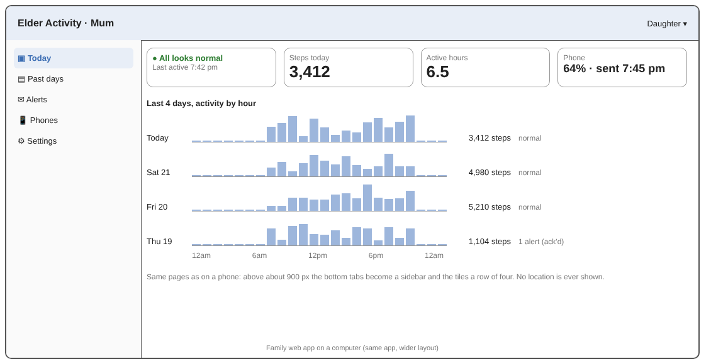
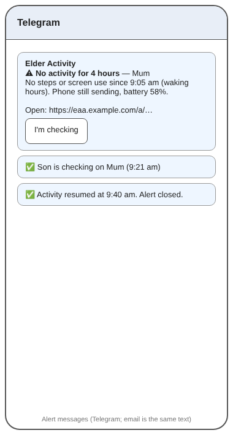
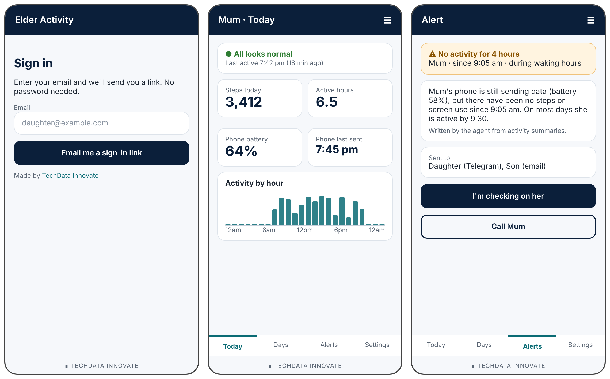

# Wireframes: family web app

Low-fidelity layouts for the family web app ([ADR 0025](../adr/0025-family-web-app.md)) and the alert messages ([ADR 0026](../adr/0026-rules-decide-llm-explains.md)). They show layout and content only; colours, fonts and the logo come from the brand file ([design.md](../design.md)). Names are neutral examples (Daughter as owner, Son as viewer, Mum as the person being looked after).

| Image | Shows | Stories |
|---|---|---|
|  | Sign in, Today, Add phone (QR), Alert, Settings at phone width | C3-1, D-1, C3-3, E-3, D-3, E-5 |
|  | The same Today page on a computer: sidebar, four tiles, last four days | D-1, D-2 |
|  | An alert, its acknowledgement and "activity resumed", as sent by Telegram (email uses the same text) | E-1, E-3, E-4 |
|  | Sign in, Today and Alert with the brand applied from [brand.example.toml](brand.example.toml) | D-4 |

There is one web app, not a separate family mobile app: the same pages adapt from phone to computer width and can be installed to the home screen.

## Changing a wireframe

Edit the `.html` file (they share `wf.css`), open it in a browser to check, then re-render the image. With Node.js and Playwright installed:

```bash
npx playwright screenshot --viewport-size=1890,720 docs/wireframes/family-phone.html docs/wireframes/family-phone.png
npx playwright screenshot --viewport-size=1130,580 docs/wireframes/family-desktop.html docs/wireframes/family-desktop.png
npx playwright screenshot --viewport-size=380,720 docs/wireframes/messages.html docs/wireframes/messages.png
```

`branded.html` is generated from `brand.example.toml` for this mockup only; in the app, the same values come from `config/brand.toml`.
